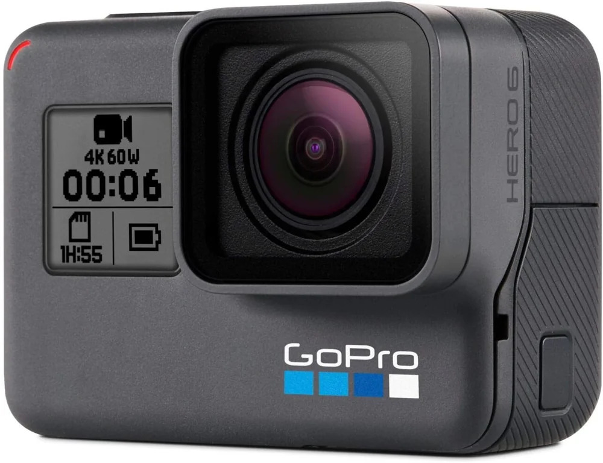
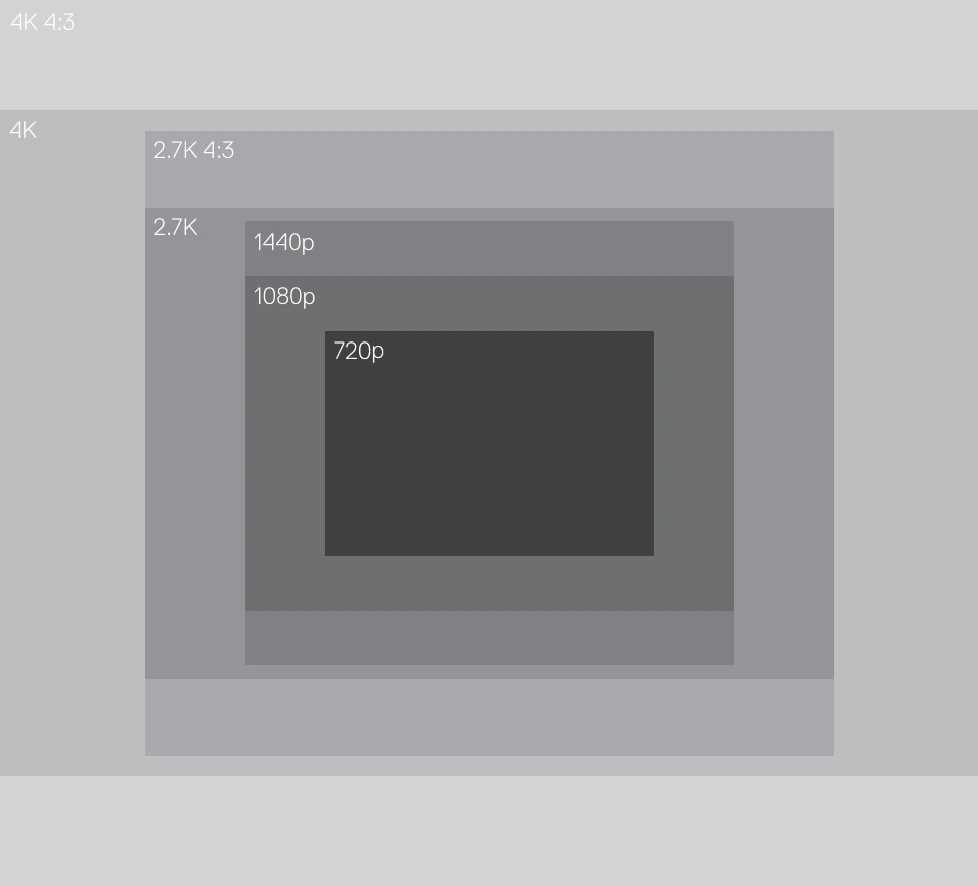

La caméra et ses réglages pour la collecte, puis les logiciels du traitement.

Caméra<b>GoPro Hero6 Black</b>

Vidéo<b>4K 4:3 · 29,97 i/s</b>

Protune<b>activé</b>

Blancs<b>6500 K</b>

## Caméra

Caméra GoPro Hero6 Black avec boîtier étanche d'origine.

<figure>

<figcaption>La GoPro Hero6 Black. Photo : GoPro</figcaption>
</figure>

Le support qui la porte devant le scooter, avec les lampes : [Le rig](/collecte/rig).

Mode de capture : **vidéo 4k 4:3** (4000 pixels x 3000 pixels). La résolution a été choisie en fonction d'une capture plein capteur.

<figure>

<figcaption>Comparaison des résolutions offertes en mode vidéo par la caméra GoPro Hero 6. Source : <cite><a href="https://gopro.com/content/dam/help/hero6-black/manuals/HERO6Black_UM_ENG_REVB.pdf">Hero 6 Black User Manual</a></cite></figcaption>
</figure>

### Paramètres de capture vidéo

| Paramètre                                              |                                 |
| ------------------------------------------------------ | ------------------------------- |
| Résolution                                             | 4k 4:3                          |
| Images par seconde                                     | 29.97                           |
| Stabilisation vidéo                                    | désactivé                       |
| Faible luminosité automatique (_Auto low light_)       | _non disponible_                |
| _Protune_                                              | activé                          |
| Couleur (profil colorimétrique)[^1]                    | _Couleur GoPro_                 |
| Équilibre des blancs[^1]                               | 6500K[^2]                       |
| ISO Minimum[^1]                                        | *(à compléter)*                 |
| ISO Maximum[^1]                                        | 1600 (valeur par défaut)        |
| Vitesse d'obturateur[^1]                               | automatique (valeur par défaut) |
| Compensation de la valeur d’exposition (Comp V.E.)[^1] | 0 (valeur par défaut)           |
| Netteté[^1]                                            | Élevée (valeur par défaut)      |

## Logiciels

[DaVinci Resolve Studio 19](https://www.blackmagicdesign.com/ca/products/davinciresolve)

[Metashape](https://www.agisoft.com/)

[Inkscape v1.3.2](https://inkscape.org/)

[Blender v4.2](https://www.blender.org/)

[Navionics Boating](https://www.navionics.com/) (Garmin) : carte des profondeurs des abords de l'écluse, d'où vient le
terrain qui entoure le modèle 3D

Scripts PowerShell

[Claude Code](https://claude.com/claude-code) (Anthropic, modèle Claude Opus) : assistant de programmation, pour le site, le
visualiseur 3D et la chaîne de publication du modèle

[^1]: Disponible lorsque le paramètre Protune est activé
[^2]: Choisi en fonction de la température de couleur des lampes,
