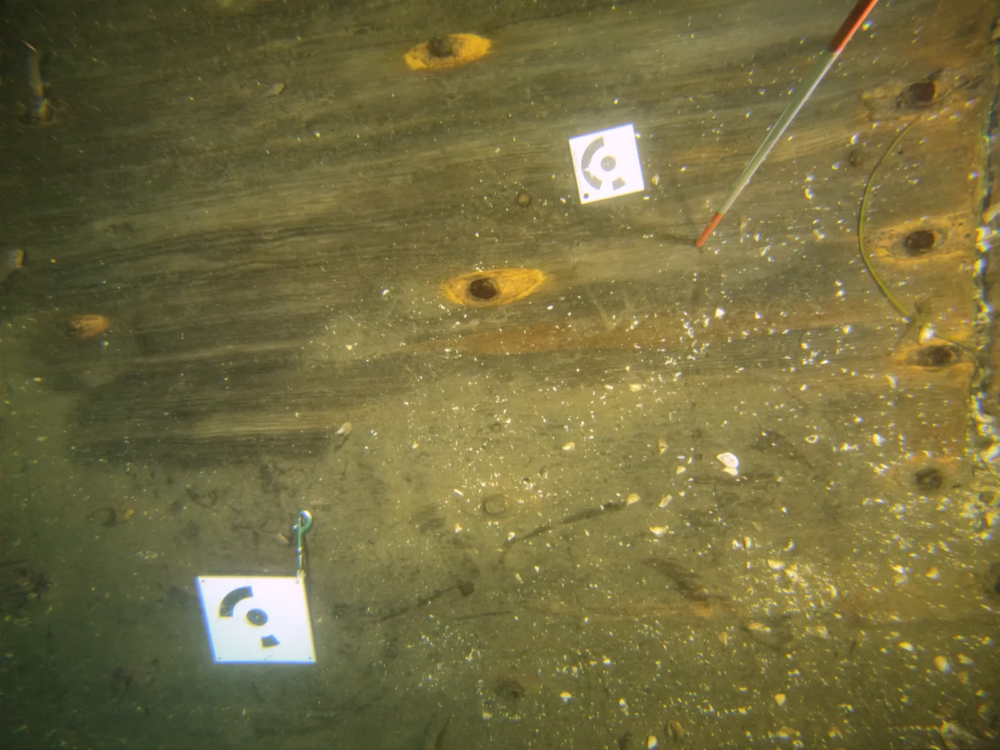

Pour que chaque modèle ait sa taille réelle et que les zones s'alignent entre elles (voir
[Alignement de chunks](/problemes/alignement-chunks)), je mesure des distances sur le site pendant les plongées : deux
cibles posées au fond, la distance entre elles mesurée, et les deux cibles filmées avec le reste de la zone. La
distance entre deux cibles forme une échelle.

Cibles<b>7,5 et 15 cm</b>

Type<b>codées, Metashape</b>

Par paires<b>cibles 1 et 2</b>

## Les cibles

Des cibles de 7,5 cm et de 15 cm, numérotées par paires (cibles 1 et 2).

<figure>

<figcaption><time datetime="2024-08-02">2024-08-02</time>Les deux types de cibles au plancher de la zone 5 : une de 7,5 cm (en haut) et une de
15 cm (en bas à gauche)</figcaption>
</figure>

Leur dessin a l'air abstrait, mais chacune porte un numéro codé. Ce sont des cibles codées circulaires de Metashape : le
point noir au centre marque l'endroit exact à mesurer, et les secteurs noirs de l'anneau autour forment le code, chaque
position de l'anneau valant un chiffre binaire, noir ou blanc. Metashape lit cet anneau sur les photos, reconnaît le
numéro de chaque cible et retrouve la même cible d'une photo à l'autre.

*(à compléter : comment les cibles sont imprimées et protégées, comment la distance est mesurée sous l'eau.)*

## Ensuite

Dans Metashape, les cibles sont détectées sur les photos et les échelles définies avec les longueurs mesurées : c'est la colonne
« Cibles détectées / Échelle(s) définie(s) » du [suivi par zone](/traitement/suivi).

*(à compléter : les étapes dans Metashape.)*
