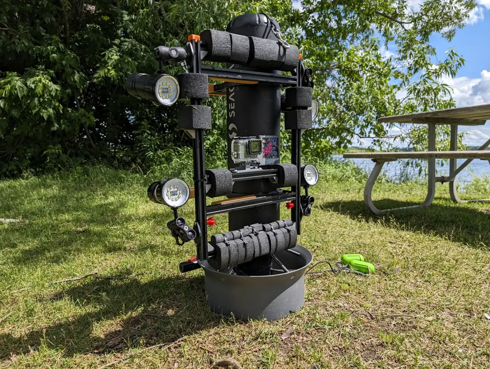
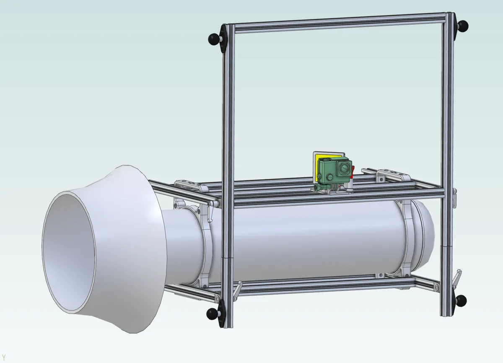
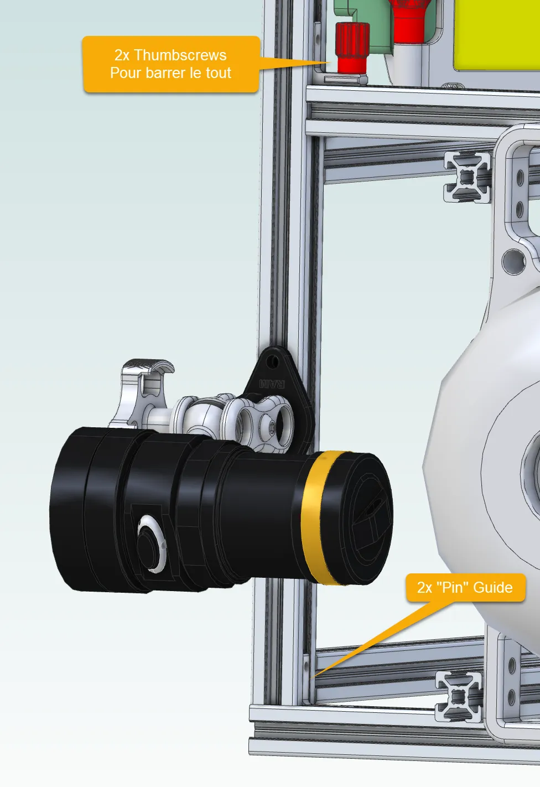
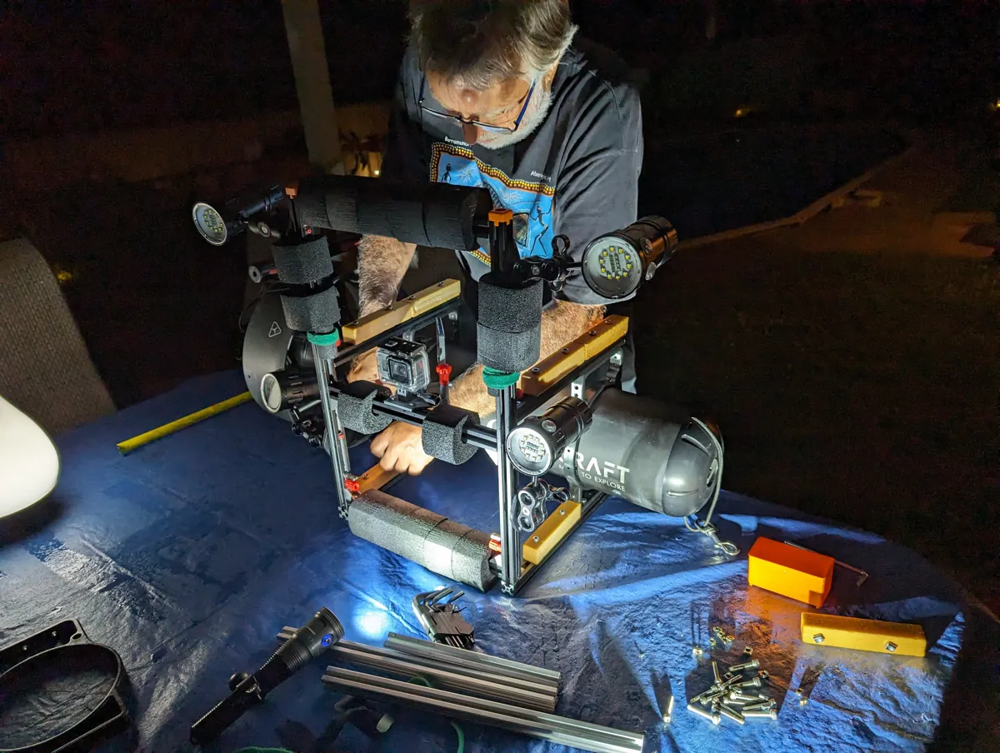
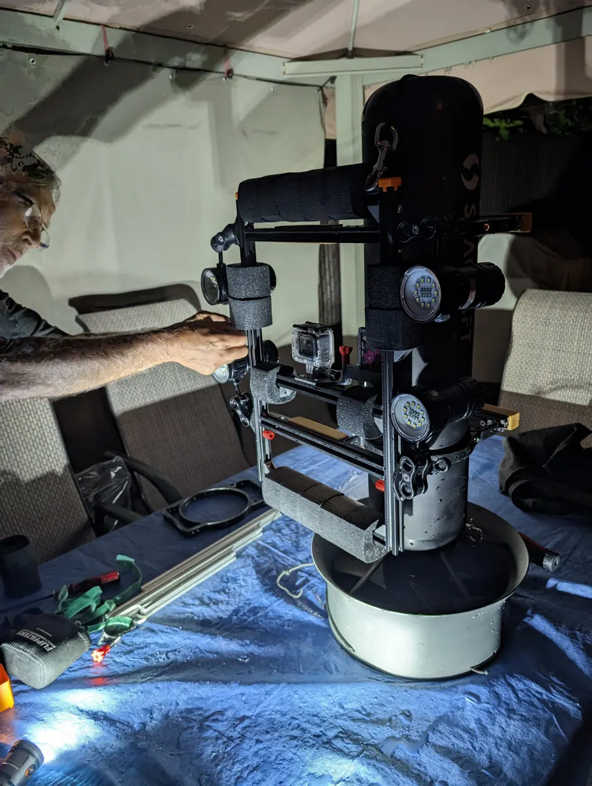
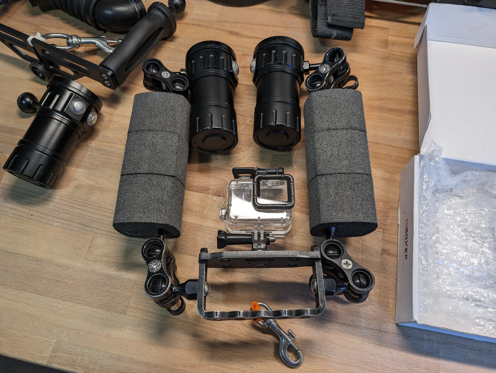
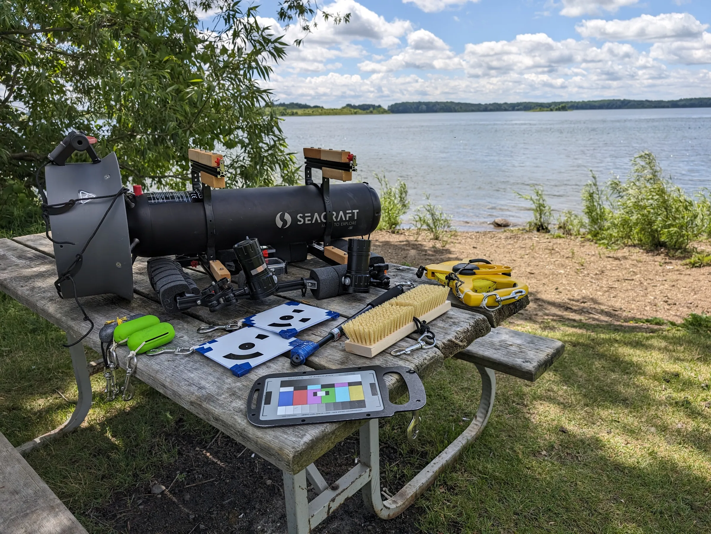

Le rig (support de caméras) porte la GoPro et les lampes devant le scooter Seacraft Future 1000. Sylvain Marcotte l'a
conçu.

Scooter<b>Seacraft Future 1000</b>

Plan filmé<b>à 70 cm</b>

Caméra<b>GoPro Hero6 Black</b>

<figure class="figure-wide">

<figcaption><time datetime="2024-06-14">2024-06-14</time>Le rig sur le scooter, avant une plongée</figcaption>
</figure>

## Construction

<figure>

<figcaption>Le rig sur le scooter, modélisé en 3D. Modèle : Sylvain Marcotte</figcaption>
</figure>

<figure>

<figcaption>Une lampe sur son support, les vis à main et les guides. Modèle : Sylvain Marcotte</figcaption>
</figure>

<figure>

<figcaption><time datetime="2024-06-08">2024-06-08</time>Sylvain Marcotte assemble le rig sur le scooter</figcaption>
</figure>

<figure>

<figcaption><time datetime="2024-06-08">2024-06-08</time>Le rig monté, le scooter debout dans un seau, avec Sylvain Marcotte</figcaption>
</figure>

Le rig est un assemblage de profilés d'aluminium à rainure en T de 20 × 20 mm (série 2020).

*(à compléter : les fixations, comment le rig s'attache au scooter.)*

## Les lampes

Les lampes sont placées pour éclairer également un plan à environ 70 cm de la lentille : 60 cm entre les deux lampes
du haut, 40 cm entre les deux lampes de droite. Les mesures sont dans [Dimensions du rig de
caméra](/problemes/dimensions-rig).

Chaque lampe est montée sur une base à rotule RAM B-238 de RAM Mounts (rotule d'un pouce), fixée au cadre.

<figure>

<figcaption><time datetime="2024-05-16">2024-05-16</time>Les lampes, les flotteurs et la GoPro dans son boîtier</figcaption>
</figure>

*(à compléter : le modèle des lampes, leur nombre et leur puissance.)*

## Le scooter

Un Seacraft Future 1000. À la vitesse 1, il avance à 1,2 pied par seconde (0,37 m/s), mesuré dans les vidéos du [test de
netteté](/problemes/nettete-images) ; ses vitesses sont programmables.

## Les brosses

Les brosses à plancher servent à préparer les surfaces avant de les filmer, le bois surtout : elles dégagent le limon
et les coquilles qui les recouvrent par endroits.

## Le matériel d'une plongée

<figure class="figure-wide">

<figcaption><time datetime="2024-06-14">2024-06-14</time>Le matériel d'une plongée : le scooter, les <a href="/collecte/mise-echelle">cibles codées</a> et la charte de couleurs</figcaption>
</figure>
