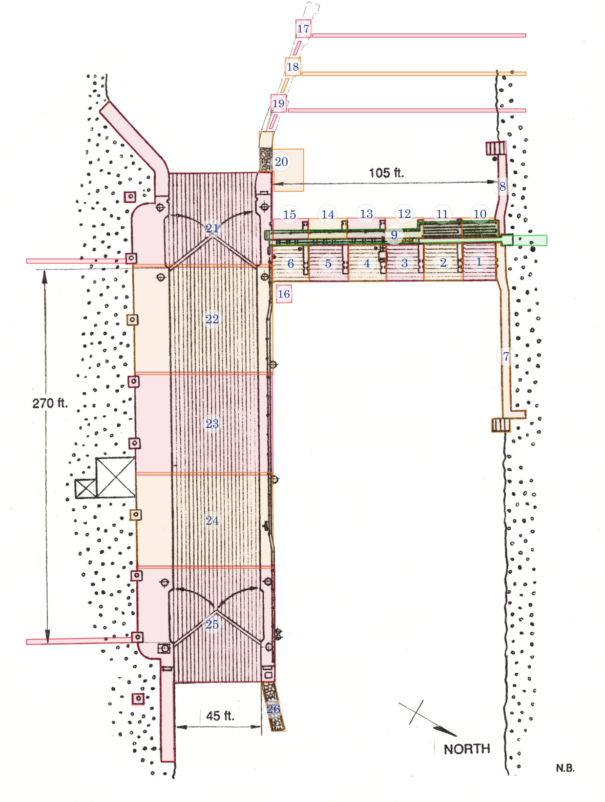

import ZoneMap from '../../components/ZoneMap.astro'

Voici le découpage du site de l'écluse en zones.

<figure className="figure-wide">

    <figcaption>Découpage du site en zones. Dessin original de Nick Baets (1988) Source : <cite><a href="https://saveontarioshipwrecks.ca/chapter-ottawa/">Save Ontario Shipwrecks - Ottawa chapter</a></cite></figcaption>

</figure>

## État des zones

Les zones en ligne dans le modèle 3D, celles relevées en plongée et pas encore publiées, et celles pas encore relevées. Une zone mène à sa description.

<ZoneMap />

## Description des zones

### Zone 1

Première enclave à l'est des évacuateurs, à l'extrémité nord. Comprends :

- le plancher, incluant le rebord à l'extrémité est
- le mur ouest, les arches ainsi que les 3 faces du rebord au-dessus

Exclue le mur qui jouxte au nord, la passerelle et le pilier au sud.

[Voir dans le modèle 3D →](/modele?cam=-17.00,3.00,-31.90,-18.00,2.94,-31.90)

### Zone 2

Enclave au sud de la zone 1. Comprends :

- le plancher, incluant le rebord à l'extrémité est
- le mur ouest, les arches ainsi que les 3 faces du rebord au-dessus
- le pilier au nord

[Voir dans le modèle 3D →](/modele?cam=-19.06,4.02,-24.80,-20.06,3.96,-24.80)

### Zone 3

Enclave au sud de la zone 2. Comprends :

- le plancher, incluant le rebord à l'extrémité est
- le mur ouest, les arches ainsi que les 3 faces du rebord au-dessus
- le pilier au nord

Exclue les 3 passages des vannes ouvertes

[Voir dans le modèle 3D →](/modele?cam=-19.06,4.02,-16.60,-20.06,3.96,-16.63)

### Zone 4

Enclave au sud de la zone 3. Comprends :

- le plancher, incluant le rebord à l'extrémité est
- le mur ouest, les arches ainsi que les 3 faces du rebord au-dessus
- le pilier au nord

[Voir dans le modèle 3D →](/modele?cam=-19.30,4.20,-8.70,-20.30,4.14,-8.70)

### Zone 5

Enclave au sud de la zone 4. Comprends :

- le plancher, incluant le rebord à l'extrémité est
- le mur ouest, les arches ainsi que les 3 faces du rebord au-dessus
- le pilier au nord

### Zone 6

Enclave au sud de la zone 5. Comprends :

- le plancher, incluant le rebord à l'extrémité est
- le mur ouest, les arches ainsi que les 3 faces du rebord au-dessus
- le pilier au nord

Exclue le mur adjacent au sud.

### Zone 7

Mur nord comprenant :

- Le dessus situé à -35 pieds de profondeur
- La structure en escaliers tout à l'est

[Voir dans le modèle 3D →](/modele?cam=-2.00,6.00,-16.00,-14.00,4.00,-33.00)

### Zone 8

Mur nord à l'ouest du déversoir. Comprends :

- Le dessus situé à -35 pieds de profondeur
- La structure en escaliers au bout, à l'ouest

[Voir dans le modèle 3D →](/modele?cam=-60.00,6.00,-20.00,-50.00,4.00,-35.00)

### Zone 9

Passerelle nord/sud située au-dessus des déversoirs. Inclue :

- Les rambardes
- Les marches à l'extrémité sud
- Les marches à l'extrémité nord

### Zone 10

Première enclave à l'ouest des évacuateurs, à l'extrémité nord. Comprends :

- le plancher de bois
- le mur est
- l'intérieur de la voûte, incluant les arches
- la face nord du pilier au sud

[Voir dans le modèle 3D →](/modele?cam=-49.98,5.21,-31.23,-39.40,4.21,-31.23)

### Zone 11

Enclave au sud de la zone 10. Comprends :

- le pilier au nord, incluant la face nord allant jusqu'à la première cannelure
- le plancher de bois
- le mur est
- l'intérieur de la voûte, incluant les arches
- la face nord du pilier au sud

[Voir dans le modèle 3D →](/modele?cam=-50.32,5.34,-23.87,-39.57,4.34,-23.87)

### Zone 12

Enclave au sud de la zone 11. Comprends :

- le pilier au nord, incluant la face nord allant jusqu'à la première cannelure
- le plancher de bois
- le mur est
- l'intérieur des 3 passages des vannes ouvertes
- l'intérieur de la voûte, incluant les arches
- la face nord du pilier au sud

[Voir dans le modèle 3D →](/modele?cam=-50.72,5.60,-16.73,-36.74,4.60,-16.73)

### Zone 13

Enclave au sud de la zone 12. Comprends :

- le pilier au nord, incluant la face nord allant jusqu'à la première cannelure
- le plancher de bois
- le mur est
- l'intérieur de la voûte, incluant les arches
- la face nord du pilier au sud

[Voir dans le modèle 3D →](/modele?cam=-50.00,3.50,-9.03,-38.75,2.47,-9.03)

### Zone 14

Enclave au sud de la zone 13. Comprends :

- le pilier au nord, incluant la face nord allant jusqu'à la première cannelure
- le plancher de bois
- le mur est
- l'intérieur de la voûte, incluant les arches
- la face nord du pilier au sud

### Zone 15

Enclave au sud de la zone 14. Comprends :

- le pilier au nord, incluant la face nord allant jusqu'à la première cannelure
- le plancher de bois
- le mur est
- l'intérieur de la voûte, incluant les arches
- la face nord du pilier au sud

### Zone 16

Porte d'une vanne de déversoir.

[Voir dans le modèle 3D →](/modele?cam=-19.26,2.35,8.01,-17.61,0.47,9.98)

### Zone 17

*(à compléter)*

### Zone 18

*(à compléter)*

[Voir dans le modèle 3D →](/modele?cam=-108.37,4.22,-3.55,-93.88,3.22,-3.55)

### Zone 19

*(à compléter)*

### Zone 20

*(à compléter)*

### Zone 21

*(à compléter)*

### Zone 22

*(à compléter)*

### Zone 23

*(à compléter)*

### Zone 24

*(à compléter)*

### Zone 25

*(à compléter)*
