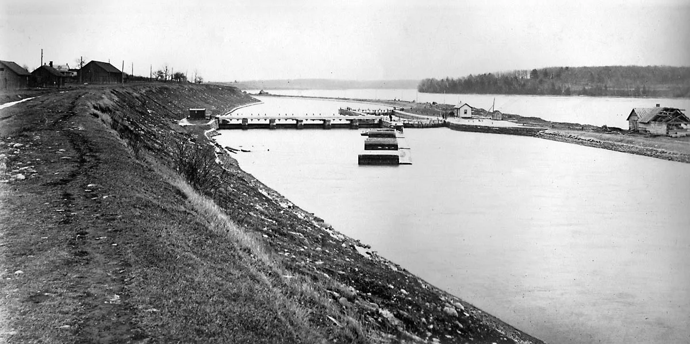
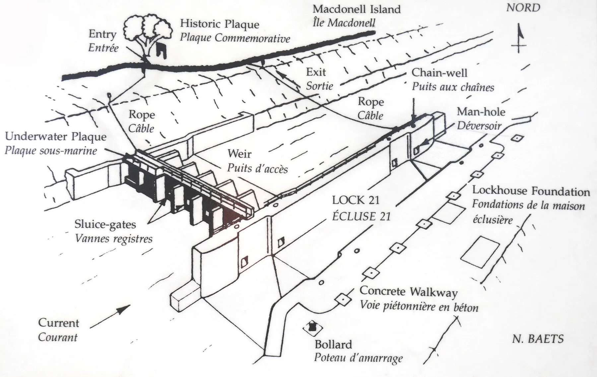

L'écluse 21 est sous 60 pieds (18,3 m) d'eau dans le Saint-Laurent, près de Long Sault (Ontario). Le dessus des piliers est à 40 pieds (12 m). Le courant y est soutenu : dans le canal de l'écluse, je l'ai [mesuré](/problemes/fort-courant-canal) à environ 35 pieds par minute (10,7 m/min) en juin 2024. Il est plus fort au-dessus du déversoir.

Profondeur<b>60 pi (18,3 m)</b>

Dessus des piliers<b>40 pi (12 m)</b>

Sas<b>270 × 45 pi</b>

Reconstruite<b>1883–1886</b>

Ennoyée<b>1er juillet 1958</b>

L'écluse 21 était la dernière écluse du canal de Cornwall, à sa tête amont, au village de Dickinson's Landing. Le canal, ouvert au début des années 1840, contournait les rapides du Long Sault, de Cornwall à Dickinson's Landing, sur environ 11 milles.

C'était une écluse de garde : pas de différence de niveau entre l'amont et l'aval. Celle qu'on plonge aujourd'hui date de l'agrandissement du canal, reconstruite de 1883 à 1886 : un sas de 270 pieds sur 45 (82 m sur 14 m), et un déversoir à son bout amont.

<figure class="figure-wide">

<figcaption>L'écluse 21 vers 1904. Source : <cite><a href="https://stlawrencepiks.com/seawayhistory/beforeseaway/cornwall/">Seaway History</a></cite></figcaption>
</figure>

Le 1er juillet 1958, le barrage Robert H. Saunders, construit pour la Voie maritime du Saint-Laurent, a noyé l'écluse, Dickinson's Landing et d'autres villages de la rive : les villages engloutis. Leurs habitants avaient été déplacés à Long Sault et à Ingleside.

En 1988 et 1989, Nick Baets et la section d'Ottawa de Save Ontario Shipwrecks ont plongé l'écluse et l'ont dessinée. Son dessin de 1988 sert de base au [découpage du site](/decoupage-site).

<figure class="figure-wide">

<figcaption>Le plan de l'écluse 21 par Nick Baets, affiché au pavillon des plongeurs de l'île Macdonell (d'après le guide de terrain de Save Ontario Shipwrecks, 1989). Source : <cite><a href="http://davidgibbins.com/journal/2016/4/8/diving-lock-21-a-submerged-victorian-canal-lock-on-the-st-lawrence-river-canada">David Gibbins, <em>Diving Lock 21</em></a></cite></figcaption>
</figure>

## Pour en savoir plus

- [Dickinson's Landing](https://lostvillages.ca/history/the-lost-villages/dickinsons-landing/), Lost Villages Historical Society : l'histoire du village, ses diligences, ses bateaux, son canal
- [Les villages engloutis](https://www.heritagetrust.on.ca/plaques/lost-villages-of-st-lawrence), Fiducie du patrimoine ontarien (en anglais)
- [Cornwall Canal](https://en.wikipedia.org/wiki/Cornwall_Canal) et [Dickinson's Landing](https://en.wikipedia.org/wiki/Dickinson%27s_Landing,_Ontario), Wikipédia (en anglais)
- [Save Ontario Shipwrecks, section d'Ottawa](https://saveontarioshipwrecks.ca/chapter-ottawa/)
