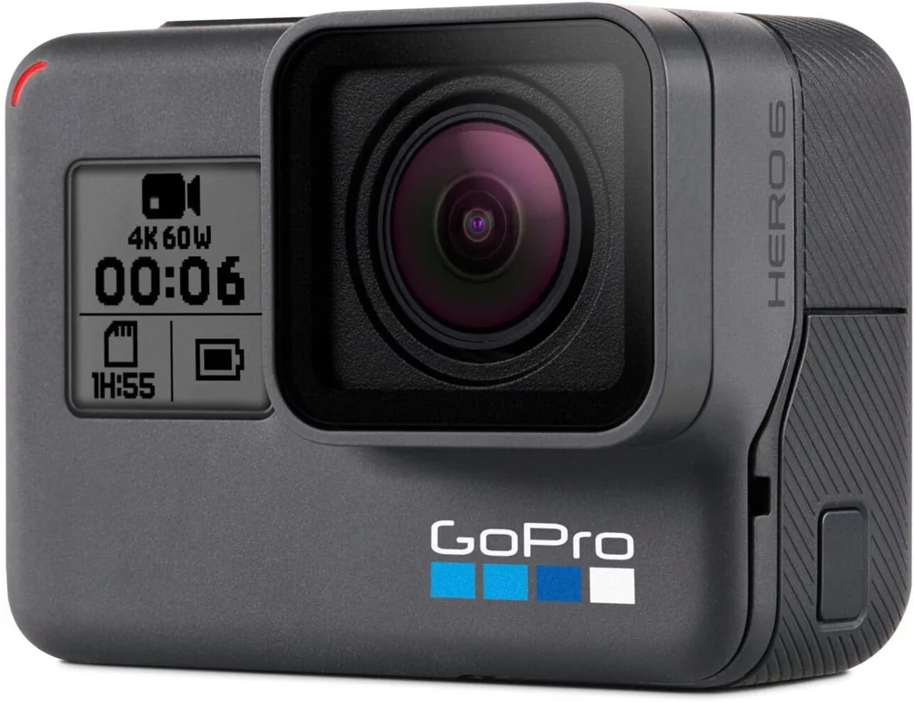
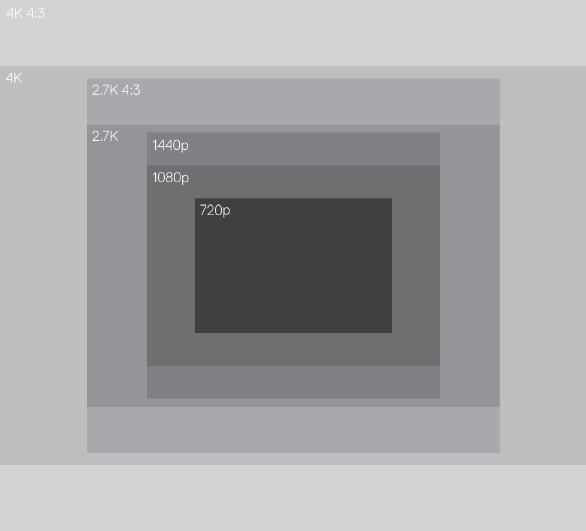

The camera and its settings for the collection, then the processing software.

Camera<b>GoPro Hero6 Black</b>

Video<b>4K 4:3 · 29.97 fps</b>

Protune<b>on</b>

White balance<b>6500 K</b>

## Camera

GoPro Hero6 Black camera in its original waterproof housing.

<figure>

<figcaption>The GoPro Hero6 Black. Photo: GoPro</figcaption>
</figure>

The frame that carries it in front of the scooter, with the lights: [The rig](/en/collecte/rig).

Capture mode: **4k 4:3 video** (4000 pixels x 3000 pixels). I picked this resolution because it captures with the full sensor.

<figure>

<figcaption>Comparison of the video resolutions offered by the GoPro Hero 6 camera. Source: <cite><a href="https://gopro.com/content/dam/help/hero6-black/manuals/HERO6Black_UM_ENG_REVB.pdf">Hero 6 Black User Manual</a></cite></figcaption>
</figure>

### Video capture settings

| Setting                                    | Value                 |
| ------------------------------------------ | --------------------- |
| Resolution                                 | 4k 4:3                |
| Frames per second                          | 29.97                 |
| Video stabilization                        | off                   |
| _Auto low light_                           | _not available_       |
| _Protune_                                  | on                    |
| Color (color profile)1                  | _GoPro Color_         |
| White balance1                          | 6500K             |
| ISO Min1                                | *(to be completed)*   |
| ISO Max1                                | 1600 (default value)  |
| Shutter speed1                          | auto (default value)  |
| Exposure value compensation (EV Comp)1  | 0 (default value)     |
| Sharpness1                              | High (default value)  |

1 Available when the Protune setting is on

## Software

[DaVinci Resolve Studio 21.1](https://www.blackmagicdesign.com/ca/products/davinciresolve)

[Metashape](https://www.agisoft.com/)

[Inkscape v1.3.2](https://inkscape.org/)

[Blender v5.2](https://www.blender.org/)

[ImageMagick v7.1](https://imagemagick.org/): lossless compression of the TIFF frames

[Navionics Boating](https://www.navionics.com/) (Garmin): depth chart of the area around the lock, where the terrain around the 3D model comes from

Node.js, Python and PowerShell scripts

[Claude Code](https://claude.com/claude-code) (Anthropic, Claude Opus model): programming assistant, for the site, the 3D viewer and the model's publishing pipeline
