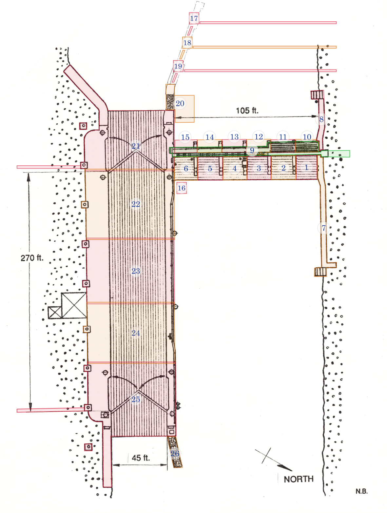

Here's how the lock site is split into zones.

<figure className="figure-wide">

    <figcaption>The site split into zones. Original drawing by Nick Baets (1988) Source: <cite><a href="https://saveontarioshipwrecks.ca/chapter-ottawa/">Save Ontario Shipwrecks - Ottawa chapter</a></cite></figcaption>

</figure>

## Zone descriptions

### Zone 1

First bay east of the spillways, at the north end. Includes:

- the floor, including the ledge at the east end
- the west wall, the arches and the 3 faces of the ledge above

Excludes the adjoining wall to the north, the walkway and the pier to the south.

### Zone 2

Bay south of zone 1. Includes:

- the floor, including the ledge at the east end
- the west wall, the arches and the 3 faces of the ledge above
- the pier to the north

### Zone 3

Bay south of zone 2. Includes:

- the floor, including the ledge at the east end
- the west wall, the arches and the 3 faces of the ledge above
- the pier to the north

Excludes the 3 passages of the open gates

### Zone 4

Bay south of zone 3. Includes:

- the floor, including the ledge at the east end
- the west wall, the arches and the 3 faces of the ledge above
- the pier to the north

### Zone 5

Bay south of zone 4. Includes:

- the floor, including the ledge at the east end
- the west wall, the arches and the 3 faces of the ledge above
- the pier to the north

### Zone 6

Bay south of zone 5. Includes:

- the floor, including the ledge at the east end
- the west wall, the arches and the 3 faces of the ledge above
- the pier to the north

Excludes the adjacent wall to the south.

### Zone 7

North wall, including:

- The top, at a depth of - 35 feet
- The stepped structure at the far east end

### Zone 8

North wall, west of the spillway. Includes:

- The top, at a depth of -35 feet
- The stepped structure at the far west end

### Zone 9

North/south walkway above the spillways. Includes:

- The railings
- The steps at the south end
- The steps at the north end

### Zone 10

First bay west of the spillways, at the north end. Includes:

- the wooden floor
- the east wall
- the inside of the vault, including the arches
- the north face of the pier to the south

### Zone 11

Bay south of zone 10. Includes:

- the pier to the north, including the north face up to the first groove
- the wooden floor
- the east wall
- the inside of the vault, including the arches
- the north face of the pier to the south

### Zone 12

Bay south of zone 11. Includes:

- the pier to the north, including the north face up to the first groove
- the wooden floor
- the east wall
- the inside of the 3 passages of the open gates
- the inside of the vault, including the arches
- the north face of the pier to the south

### Zone 13

Bay south of zone 12. Includes:

- the pier to the north, including the north face up to the first groove
- the wooden floor
- the east wall
- the inside of the vault, including the arches
- the north face of the pier to the south

### Zone 14

Bay south of zone 13. Includes:

- the pier to the north, including the north face up to the first groove
- the wooden floor
- the east wall
- the inside of the vault, including the arches
- the north face of the pier to the south

### Zone 15

Bay south of zone 14. Includes:

- the pier to the north, including the north face up to the first groove
- the wooden floor
- the east wall
- the inside of the vault, including the arches
- the north face of the pier to the south

### Zone 16

A spillway gate.

### Zone 17

#### Zone 18

#### Zone 19

#### Zone 20

#### Zone 21

#### Zone 22

#### Zone 23

#### Zone 24

#### Zone 25
