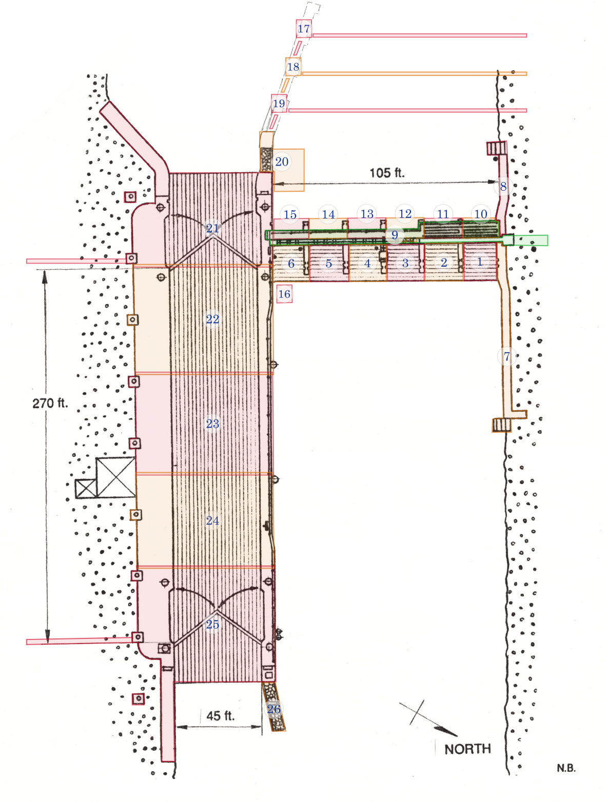

import ZoneMap from '../../../components/ZoneMap.astro'

Here's how the lock site is split into zones.

<figure className="figure-wide">

    <figcaption>The site split into zones. Original drawing by Nick Baets (1988) Source: <cite><a href="https://saveontarioshipwrecks.ca/chapter-ottawa/">Save Ontario Shipwrecks - Ottawa chapter</a></cite></figcaption>

</figure>

## The zones' state

The zones online in the 3D model and those not surveyed yet. A zone leads to its description.

<ZoneMap />

## Zone descriptions

### Zone 1

First bay east of the spillways, at the north end. Includes:

- the floor, including the ledge at the east end
- the west wall, the arches and the 3 faces of the ledge above

Excludes the adjoining wall to the north, the walkway and the pier to the south.

[See it in the 3D model →](/en/modele?cam=-17.00,3.00,-31.90,-18.00,2.94,-31.90)

[See it in the 3D model →](/en/modele?cam=-17.00,3.00,-31.90,-18.00,2.94,-31.90)

### Zone 2

Bay south of zone 1. Includes:

- the floor, including the ledge at the east end
- the west wall, the arches and the 3 faces of the ledge above
- the pier to the north

[See it in the 3D model →](/en/modele?cam=-19.06,4.02,-24.80,-20.06,3.96,-24.80)

[See it in the 3D model →](/en/modele?cam=-19.06,4.02,-24.80,-20.06,3.96,-24.80)

### Zone 3

Bay south of zone 2. Includes:

- the floor, including the ledge at the east end
- the west wall, the arches and the 3 faces of the ledge above
- the pier to the north

Excludes the 3 passages of the open gates

[See it in the 3D model →](/en/modele?cam=-19.06,4.02,-16.60,-20.06,3.96,-16.63)

[See it in the 3D model →](/en/modele?cam=-19.06,4.02,-16.60,-20.06,3.96,-16.63)

### Zone 4

Bay south of zone 3. Includes:

- the floor, including the ledge at the east end
- the west wall, the arches and the 3 faces of the ledge above
- the pier to the north

[See it in the 3D model →](/en/modele?cam=-19.30,4.20,-8.70,-20.30,4.14,-8.70)

[See it in the 3D model →](/en/modele?cam=-19.30,4.20,-8.70,-20.30,4.14,-8.70)

### Zone 5

Bay south of zone 4. Includes:

- the floor, including the ledge at the east end
- the west wall, the arches and the 3 faces of the ledge above
- the pier to the north

### Zone 6

Bay south of zone 5. Includes:

- the floor, including the ledge at the east end
- the west wall, the arches and the 3 faces of the ledge above
- the pier to the north

Excludes the adjacent wall to the south.

### Zone 7

North wall, including:

- The top, at a depth of - 35 feet
- The stepped structure at the far east end

[See it in the 3D model →](/en/modele?cam=-2.00,6.00,-16.00,-14.00,4.00,-33.00)

[See it in the 3D model →](/en/modele?cam=-2.00,6.00,-16.00,-14.00,4.00,-33.00)

### Zone 8

North wall, west of the spillway. Includes:

- The top, at a depth of -35 feet
- The stepped structure at the far west end

[See it in the 3D model →](/en/modele?cam=-60.00,6.00,-20.00,-50.00,4.00,-35.00)

[See it in the 3D model →](/en/modele?cam=-60.00,6.00,-20.00,-50.00,4.00,-35.00)

### Zone 9

North/south walkway above the spillways. Includes:

- The railings
- The steps at the south end
- The steps at the north end

### Zone 10

First bay west of the spillways, at the north end. Includes:

- the wooden floor
- the east wall
- the inside of the vault, including the arches
- the north face of the pier to the south

[See it in the 3D model →](/en/modele?cam=-49.98,5.21,-31.23,-39.40,4.21,-31.23)

[See it in the 3D model →](/en/modele?cam=-49.98,5.21,-31.23,-39.40,4.21,-31.23)

### Zone 11

Bay south of zone 10. Includes:

- the pier to the north, including the north face up to the first groove
- the wooden floor
- the east wall
- the inside of the vault, including the arches
- the north face of the pier to the south

[See it in the 3D model →](/en/modele?cam=-50.32,5.34,-23.87,-39.57,4.34,-23.87)

[See it in the 3D model →](/en/modele?cam=-50.32,5.34,-23.87,-39.57,4.34,-23.87)

### Zone 12

Bay south of zone 11. Includes:

- the pier to the north, including the north face up to the first groove
- the wooden floor
- the east wall
- the inside of the 3 passages of the open gates
- the inside of the vault, including the arches
- the north face of the pier to the south

[See it in the 3D model →](/en/modele?cam=-50.72,5.60,-16.73,-36.74,4.60,-16.73)

[See it in the 3D model →](/en/modele?cam=-50.72,5.60,-16.73,-36.74,4.60,-16.73)

### Zone 13

Bay south of zone 12. Includes:

- the pier to the north, including the north face up to the first groove
- the wooden floor
- the east wall
- the inside of the vault, including the arches
- the north face of the pier to the south

[See it in the 3D model →](/en/modele?cam=-50.00,3.50,-9.03,-38.75,2.47,-9.03)

[See it in the 3D model →](/en/modele?cam=-50.00,3.50,-9.03,-38.75,2.47,-9.03)

### Zone 14

Bay south of zone 13. Includes:

- the pier to the north, including the north face up to the first groove
- the wooden floor
- the east wall
- the inside of the vault, including the arches
- the north face of the pier to the south

### Zone 15

Bay south of zone 14. Includes:

- the pier to the north, including the north face up to the first groove
- the wooden floor
- the east wall
- the inside of the vault, including the arches
- the north face of the pier to the south

### Zone 16

A spillway gate.

[See it in the 3D model →](/en/modele?cam=-19.26,2.35,8.01,-17.61,0.47,9.98)

[See it in the 3D model →](/en/modele?cam=-19.26,2.35,8.01,-17.61,0.47,9.98)

### Zone 17

*(to be completed)*

### Zone 18

*(to be completed)*

[See it in the 3D model →](/en/modele?cam=-108.37,4.22,-3.55,-93.88,3.22,-3.55)

[See it in the 3D model →](/en/modele?cam=-108.37,4.22,-3.55,-93.88,3.22,-3.55)

### Zone 19

*(to be completed)*

### Zone 20

*(to be completed)*

### Zone 21

*(to be completed)*

### Zone 22

*(to be completed)*

### Zone 23

*(to be completed)*

### Zone 24

*(to be completed)*

### Zone 25

*(to be completed)*
