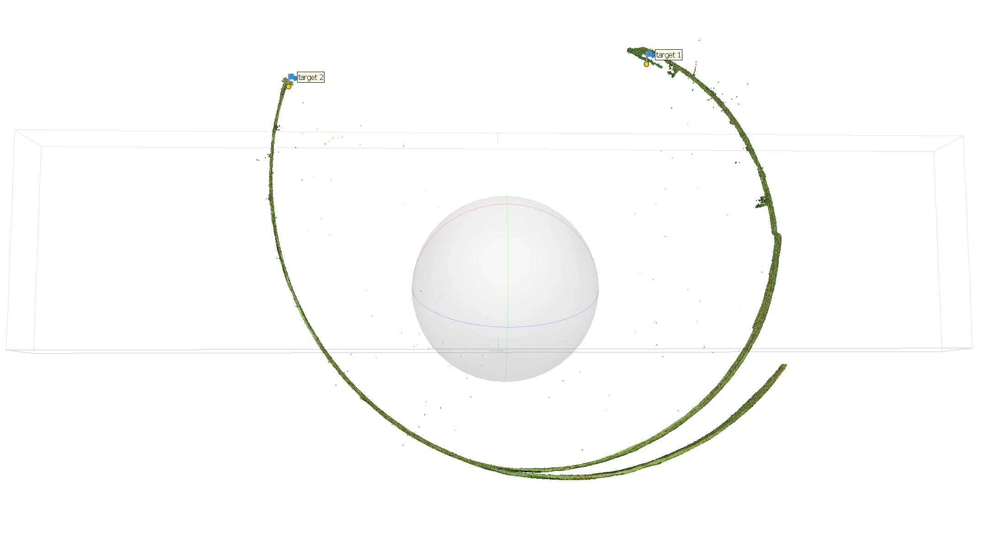
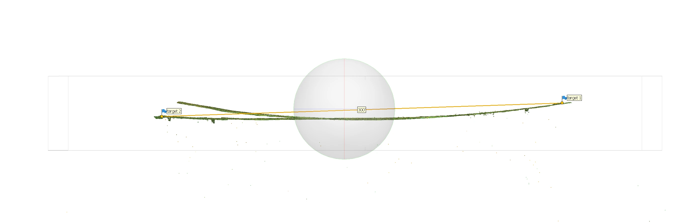
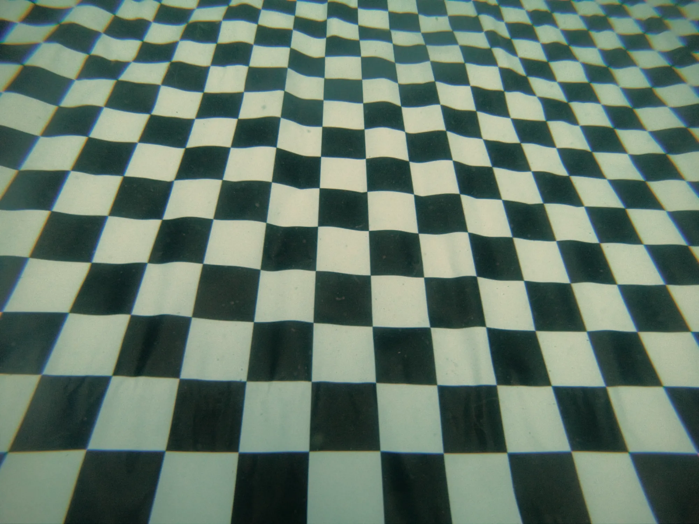
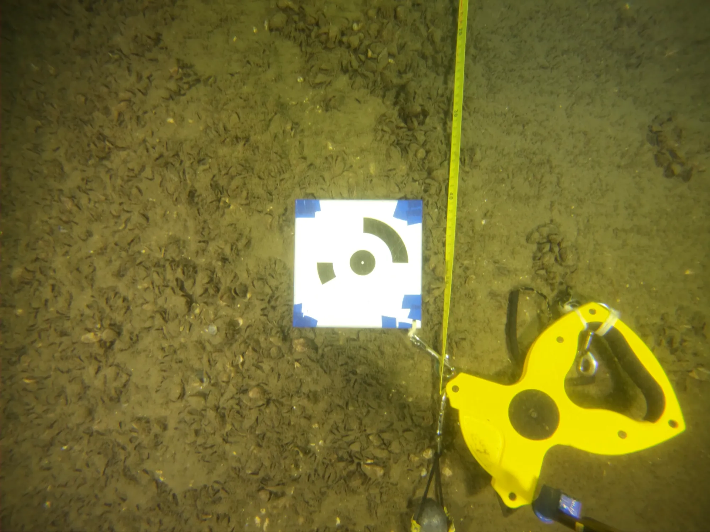

A test on a flat surface 100 feet long shows that the model produced by aligning the cameras in the photogrammetry software is distorted. Instead of a flat surface, it comes out bent like a banana.

On a longer segment the effect is plain to see: the 300 feet of the top of the canal's south wall, filmed on July 26, 2024 between targets 1 and 2 (dive 27), curl up almost into a circle.

Segment<b>300 ft</b>

Filmed<b>2024-07-26</b>

Dive<b>27</b>

<figure>

<figcaption><time datetime="2024-07-26">2024-07-26</time>The 300-foot segment, distorted: it curls up between targets 1 and 2</figcaption>
</figure>

<figure>

<figcaption><time datetime="2024-07-26">2024-07-26</time>The same segment, corrected: almost straight, with the 300-foot scale between targets 1 and 2</figcaption>
</figure>

- Where does this distortion come from?
- How do I fix it?

## Hypothesis

My guess is that the banana effect comes from the distortion of the images by the GoPro Hero 6 Black's lens.

Tests on the same set of images (the files `data/2024-05-18/raw-frames-n8/échelle-1`) with 2 different camera calibration files, namely the one obtained from Metashape's processing of the `data/2024-05-18/raw-frames-n8/pilier-3` set, `configs/camera-calibration/camera-calibration from 2024-05-18 pillier 3.xml`, and the file used for the Robert Gaskin project, `configs/camera-calibration/GoPro HERO6 4k wide frame camera calibration.xml`, give different curvatures: the result made with the calibration from the Robert Gaskin project is less curved. So the camera calibration can be tweaked to correct the banana effect.

## Possible solutions

1. Calibrate the camera
2. Crop the edges of the images with a mask
3. Use a less wide-angle lens

## Camera calibration

Collect data to calibrate the GoPro's lens.

Calibration Best Practices: [https://calib.io/blogs/knowledge-base/calibration-best-practices](https://calib.io/blogs/knowledge-base/calibration-best-practices)

## In detail

Since the lens's focal length changes with the medium, the test has to be done underwater.

Pick a calm body of water, with no current and the best possible visibility. A pool or a quarry, for example.

The test will be done at the Bédard quarry in Kahnawake, on Sunday, May 26, 2024.

To make sure the data collection goes well, and to keep the images from being too overexposed, run the following tests with 4 lights, then with 2 lights.

1. Lay a large checkerboard on a flat surface. Avoid stirring up sediment as much as possible so as not to spoil the visibility.
2. Shoot short videos (3 seconds) in 4K 4:3 of the checkerboard from every possible angle. Cover the camera's whole field of view with the checkerboard

<figure>

<figcaption>Image used to compute the lens calibration</figcaption>
</figure>

## Processing in Metashape

3 data samples were created by filming a 100-foot-long stretch of the wooden floor behind the spillways. The 100-foot distance was measured with a measuring tape. The 0' and 100' positions were marked with 2 targets.

<figure>

<figcaption>Target used to mark the 100-foot position</figcaption>
</figure>

### Sample 1

Video shot finning, in 4K 16:9.

## Conclusions

*(to be completed)*
