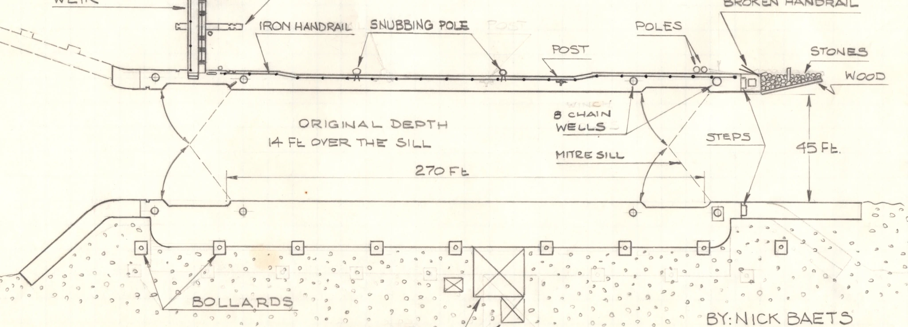

Test data collection in a strong current with the camera mounted on the scooter

- Test how the scooter/rig/camera combo behaves in a strong current
- How fast does the water flow in the parts exposed to the current? Too fast?

I ran a test (2024-06-08) by drifting through the canal between the 2 gates, knowing it's 270 feet long. The length of the footage gives the elapsed time, so I'll get an estimate of the drift speed.

<figure>

<figcaption>Sketch (detail) showing the length of the lock canal. Original drawing by Nick Baets (1988) Source: <cite><a href="https://saveontarioshipwrecks.ca/chapter-ottawa/">Save Ontario Shipwrecks - Ottawa chapter</a></cite></figcaption>
</figure>

|       |                                      |
| ----- | ------------------------------------ |
| Start | 26 seconds                           |
| End   | 8 minutes 9 seconds                  |
| Duration | 7 minutes 43 seconds (463 seconds) |

Estimated speed: **35 feet/minute** (10.7 metres/minute)

The [Lake Ontario outflow recorded for that day, June 8, 2024, is 7,880 m3/s](https://ijc.org/en/loslrb/watershed/flows).
