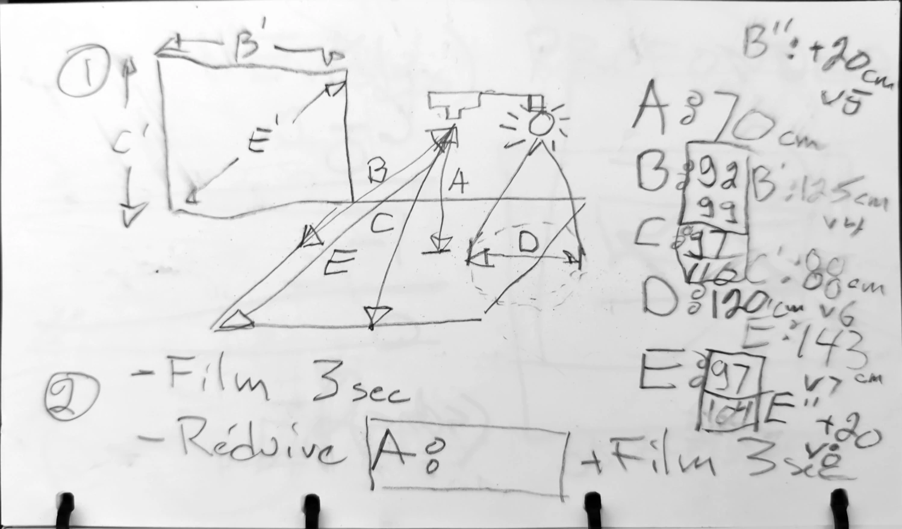
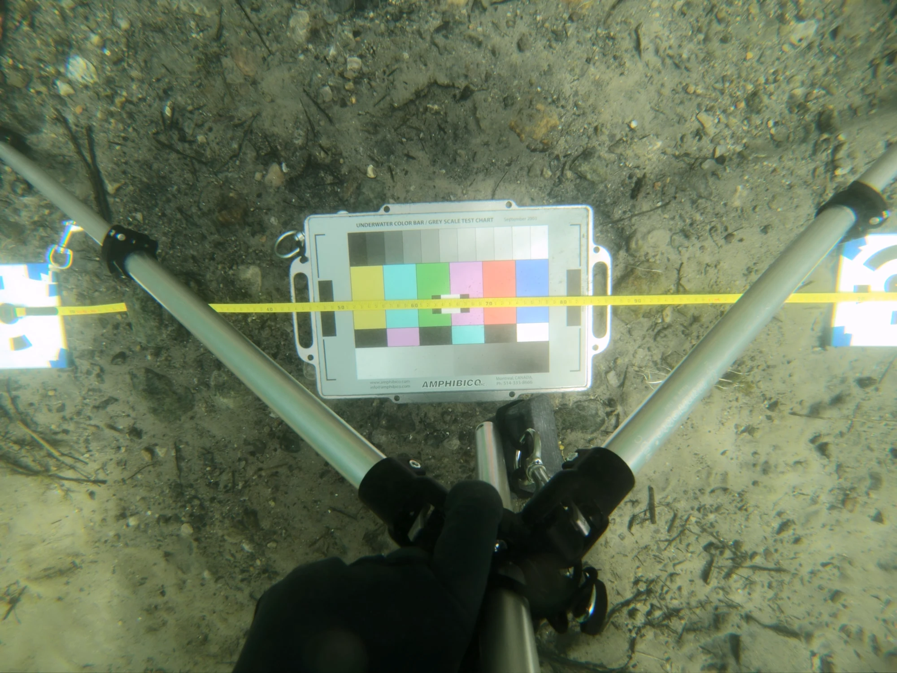
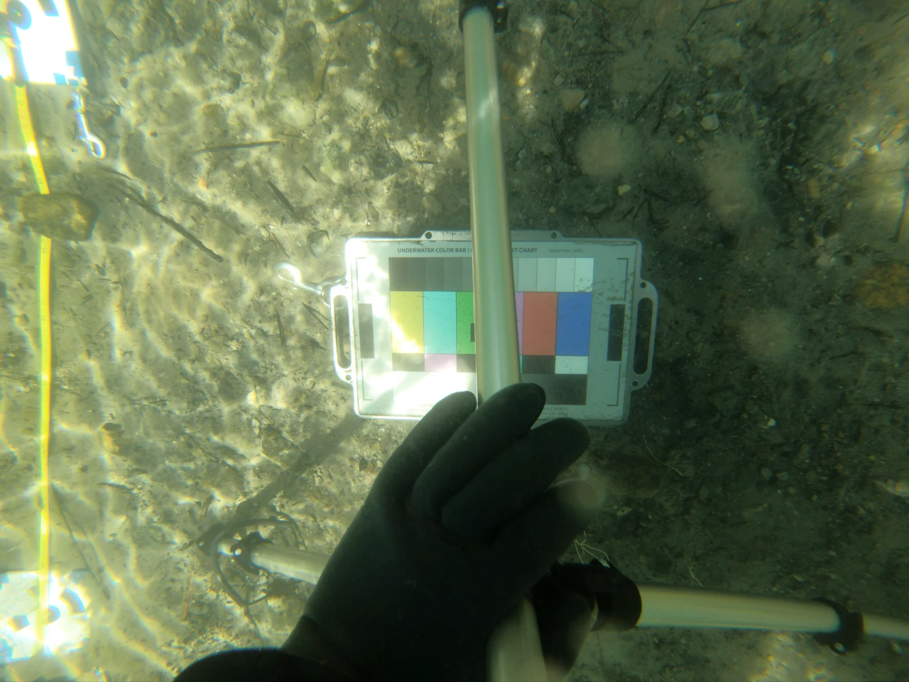
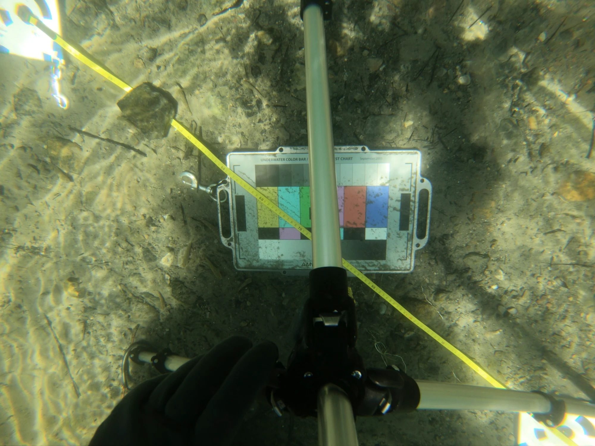

## Lens field of view

Rectangle measured on the ground, with the camera lens placed 70cm above it, held parallel to the ground on a tripod.

Lens &lt;-&gt; ground distance: 70cm

### Measuring

Measuring the dimensions of the GoPro lens's field of view turned out to be harder than expected. Indeed,

<figure>

<figcaption>Dive plan drawn in a waterproof notebook</figcaption>
</figure>

<figure>

<figcaption>Image used to measure the horizontal field of view</figcaption>
</figure>

<figure>

<figcaption>Image used to measure the vertical field of view</figcaption>
</figure>

<figure>

<figcaption>Image used to measure the diagonal field of view</figcaption>
</figure>

Long side "B": 125cm measured + 1,5cm, i.e. half the width of the target's black circle sticking out (on the left) = 126,5cm

Short side "C": 88cm measured + 1,5cm, i.e. half the width of the target's black circle sticking out (at the top) + 7,5cm ( ½ _ target height) + 4,5cm (0,3 _ target height sticking out at the bottom): 101.5cm

Diagonal "E": 155,6cm, worked out with the rule of three

## Lens angles of view

Manufacturer's specifications. 4:3 W (zoom=0%)

|            | Angle          |
| ---------- | -------------- |
| Diagonal   | 149.5 degrees |
| Horizontal | 122.6 degrees |
| Vertical   | 94.4 degrees  |

Source: [https://community.gopro.com/s/article/hero6-black-field-of-view-fov-information?language=en_US]

From the measurements above:

|            | Angle       |
| ---------- | ----------- |
| Diagonal   | 96 degrees |
| Horizontal | 84 degrees |
| Vertical   | 72 degrees |

### Field of view angle ratios, experiment vs specification

|            | Specification | Measured | Ratio |
| ---------- | ------------- | -------- | ----- |
| Diagonal   | 149.5         | 96       | 0,642 |
| Horizontal | 122.6         | 84       | 0,685 |
| Vertical   | 94.4          | 72       | 0,763 |

[TODO: revisit this section: the lens distortion makes the angle of view wider at the edges. For the project, I chose the useful angle of view, the one measured at the centre of the image.]

The most reliable measurement is the **horizontal** one, since the targets were best placed when the shot was taken, and the measurement was made at the centre (unlike the vertical measurement, which was made at the edge of the camera's field of view, where the lens distortion is strongest).

Distance between lateral passes depending on the distance to the subject

| Image overlap | 50cm | 70cm | 90cm |
| :----------------: | :--: | :--: | ---- |
|        80%         | 18cm | 25cm | 32cm |
|        75%         | 22cm | 30cm | 40cm |
|        70%         | 27cm | 38cm | 49cm |

### Light beam angle

81,2 degrees diagonal.

The measurements were taken with a tripod submerged underwater and set on a flat, rocky bottom. The light was 70 cm from the measured surface. The measured diagonal is 120 cm.

## Rig

Measure, in centimetres, the distances between the rig's lights once they are positioned to give even lighting on a plane at the "normal" shooting distance. This will make it possible to model the rig accurately.

Measurement "X" is the horizontal distance between the centres of the 2 top lights. Measurement "Y" is the vertical distance between the 2 lights on the right.

1. Distance X: 60cm
2. Distance Y: 40cm
3. Distance between the camera lens and the filmed plane: 70cm
