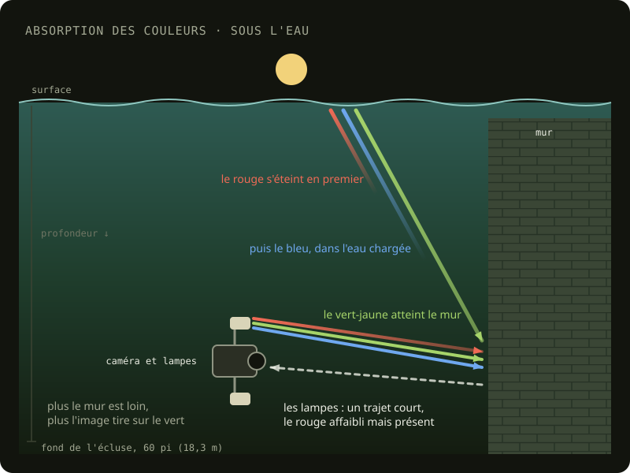
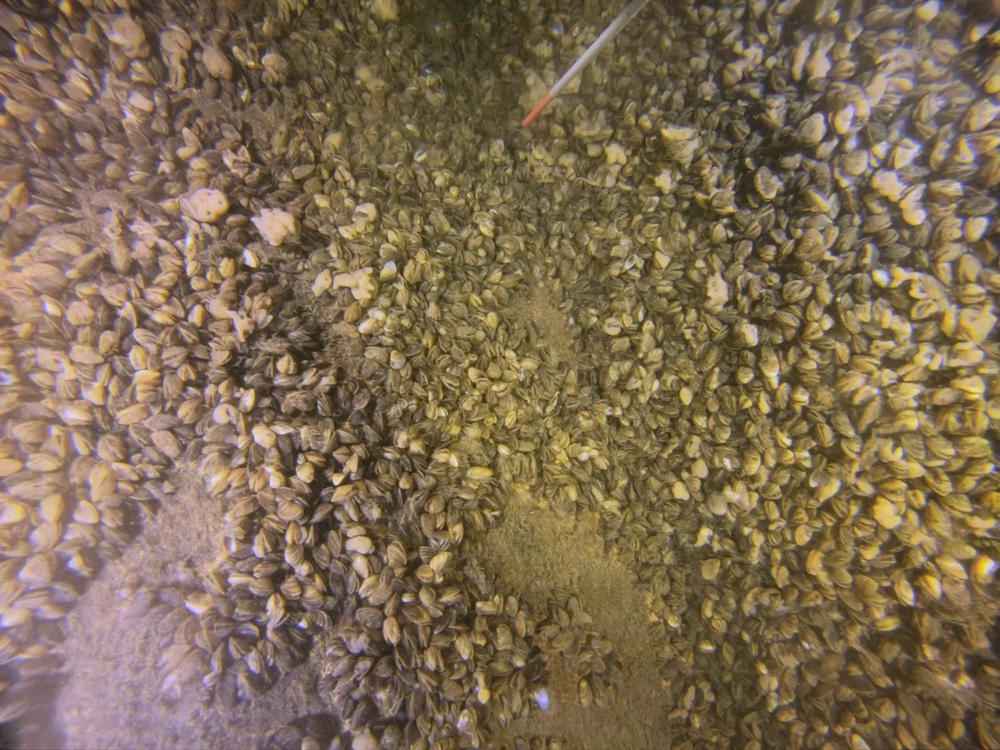
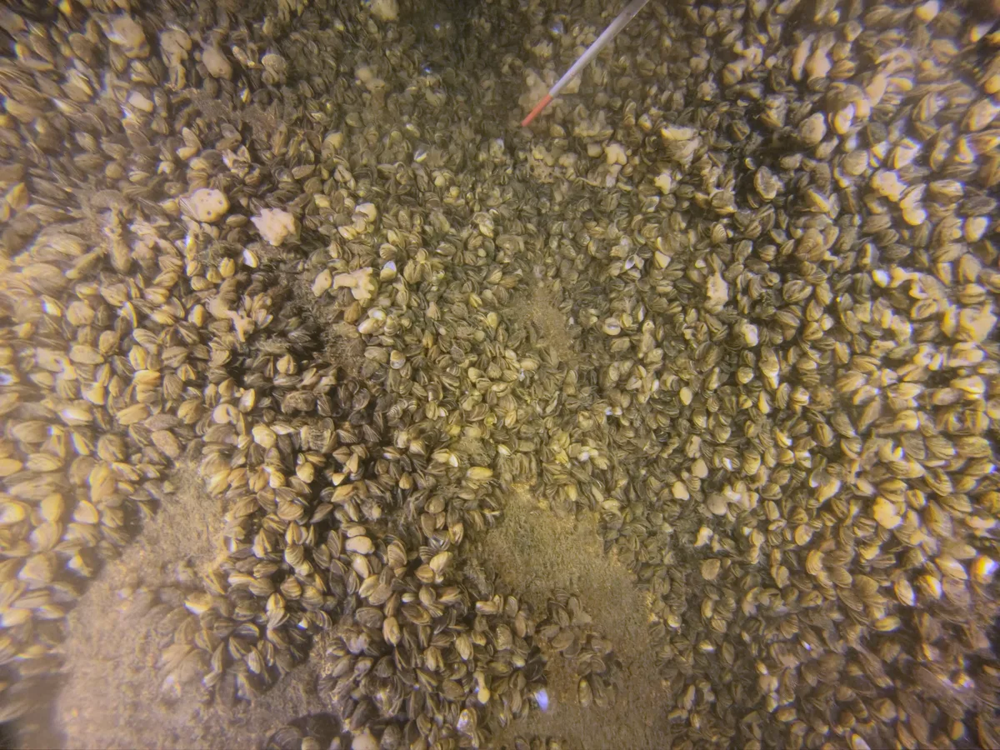
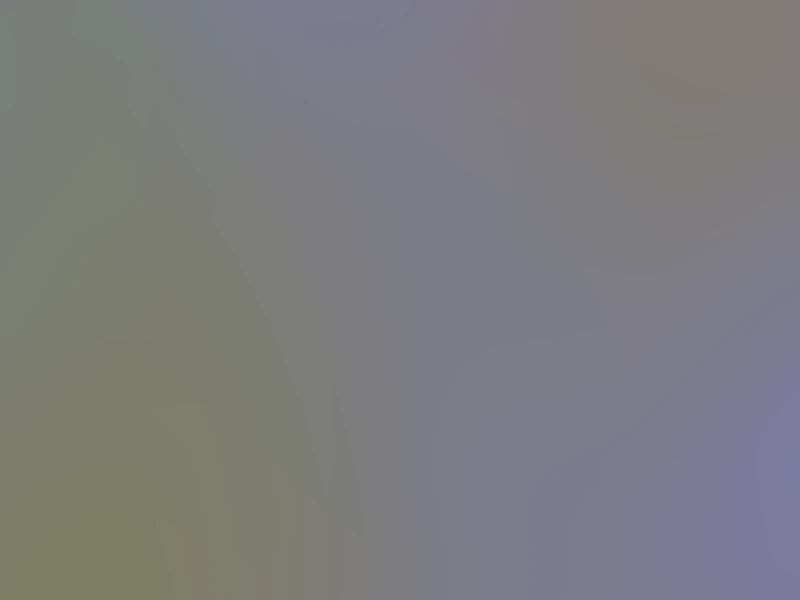

Underwater, two lights fall on what I film: daylight, coming down from the surface, and the four lights of the [rig](/en/collecte/rig#the-lights), white LEDs at 6000 K. Water doesn't let every colour through the same way: it absorbs red first and, in the canal's murky water, a good part of the blue too. The more water the light goes through, the more the image turns green-yellow. So daylight changes with depth, and the lights' colour with the distance between the rig and what it films.

<figure id="absorption">

<figcaption>Water absorbs the colours of light, red first. Daylight, which goes through the whole depth, arrives green-yellow. The lights, a short distance from the subject, keep almost all their colours, which makes it possible to restore the colours the ambient light has lost.</figcaption>
</figure>

In the camera, the white balance stays fixed at 6500 K ([Gear used](/en/collecte/materiel-utilise)). The correction comes afterward in DaVinci Resolve, based on the colour chart filmed at the start of each dive, underexposed by one stop ([The colour chart is overexposed](/en/problemes/charte-couleurs-surexposee)). On some dives I filmed the chart at two heights, on the floor and halfway up, and made a grade for each ([Colour calibration](/en/problemes/calibration-couleurs)).

## The added correction

In October 2026, a common correction was added to the chart's grade, one per dive, with the help of the AI tool Claude. The average colour of each pass, measured on about twenty frames, is brought three quarters of the way to neutral grey, and the dive's correction is the median of its passes. A single correction per dive avoids colour bands in the texture where the frames of two passes blend. For dive 21 and the July 14 dive, flatter than the others, the contrast is raised to the level of the other dives.

Each dive's correction is saved in a LUT file (_look-up table_, a table that gives the corrected colour for each colour of the image). In a copy of the dive's Resolve project, named `… - graded`, this file goes on the timeline's node, which applies to every frame after its own grade, then the frames are rendered into a new folder under the same names. The original projects and frames stay as they are. The corrected frames then go on to [photo extraction](/en/traitement/extraction-photos).

## The lights at the centre of the image

Once a zone's texture was redone with these frames, yellow patches appeared on the floor of zone 3. The dive's correction brings the image's average colour to neutral, but the colour isn't the same everywhere in the image: the rig's lights give the centre a warm light, while the edges are lit by the water, greener or bluer. Measured on a few hundred frames of a dive, the share of blue doubles between the centre and the corners. After the common correction, the centre stays yellow and the edges lean magenta. For the texture, Metashape takes each part of the surface from the photo that sees it best, often the one where it sits at the centre. A yellow patch is a part taken from the centre of a photo, and its outline is the change to another photo.

<figure id="lampes-avant">

<figcaption><time datetime="2024-08-18">2024-08-18</time> Zone 4, with the dive's correction only: the centre yellow, the edges pinkish.</figcaption>
</figure>

<figure id="lampes-apres">

<figcaption><time datetime="2024-08-18">2024-08-18</time> The same image, its colour evened out across the frame.</figcaption>
</figure>

<figure id="carte-correction">

<figcaption>The correction map for the passes under the lights on the August 18, 2024 dive: a neutral grey multiplied by the correction of each spot in the image. Bluish where it adds blue (under the lights), yellowish where it removes it (the edges lit by the water).</figcaption>
</figure>

Since the lights move with the camera, this pattern is the same from one frame to the next. For each dive, or each group of passes lit the same way, the average colour of each spot in the image is measured on 400 frames by a script written with AI, then smoothed. Each spot then gets the correction that brings its colour to that of the whole image, without changing its brightness. Only the hue is evened out: the centre, better lit, stays brighter. This correction map is then applied to all the dive's frames before the texture is redone.
