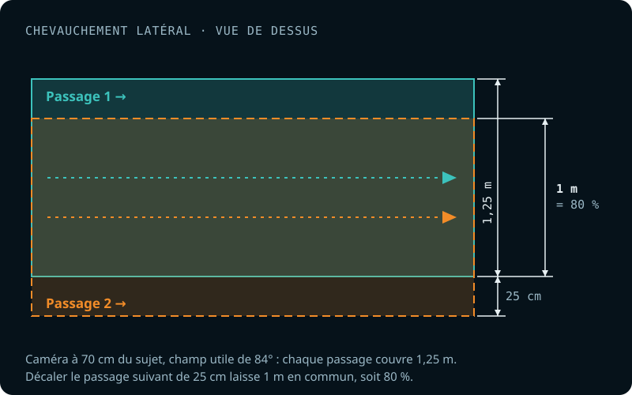
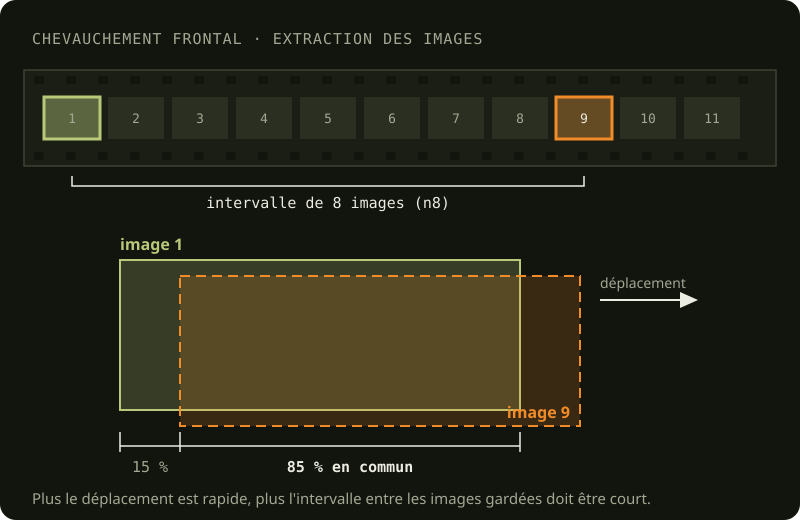

This step pulls still photos out of the videos I shot. I do it in DaVinci Resolve Studio.

The videos were shot with a GoPro Hero6 Black. The camera, its housing and its settings are described in [Gear used](/en/collecte/materiel-utilise).

The clips are first colour-graded in DaVinci Resolve ([Colour grading](/en/traitement/etalonnage-couleurs)), then rendered as frames.

## Renaming the videos

Before colour grading, I rename the videos in their `raw-4k` folder with Bulk Rename Utility (preset `O:\scripts\renameFiles.bru`). The GoPro puts the chapter number before the video's: `GX020333.MP4` is chapter 02 of video 0333. The renaming swaps the two, which keeps the chapters of a video together when the files are sorted by name:

| Pattern | Replacement | Before | After |
| --- | --- | --- | --- |
| `GX(\d{2})(\d+)(.*)` | `GX\2\1\3` | `GX020333.MP4` | `GX033302.MP4` |

The frames extracted then take their video's name, followed by their number: `GX033001.0001.tif`.

This preset dates from July 2024. Earlier videos have other name forms (`GX0019201`, `GX002071`), and those of zone 7 on June 24, 2024 kept their original name (`GX010247`).

## Image overlap

The Metashape documentation recommends 80% frontal and 60% side overlap, and 90% frontal and 80% side overlap for a survey over a forest. I chose to aim for 85% overlap, both frontal and side.

### Side overlap

Side overlap is controlled during data collection. So while filming an object, it's important to keep in mind the path you're drawing, so you can plan the next one to get roughly 80% overlap between passes.

<figure>

<figcaption>Two passes with 80 % overlap: at 70 cm from the subject, each pass covers a 1.25 m strip. The next one is shifted by 25 cm (see <a href="/en/problemes/dimensions-rig">Camera rig dimensions</a>).</figcaption>
</figure>

### Frontal overlap

Frontal overlap, on the other hand, is set when extracting the frames from the videos. While watching the footage, I estimate the interval needed between 2 frames to get roughly 85% overlap.

[Explain how I use effects in DaVinci Resolve to show an 85% frame that helps judge the sampling factor.]

<figure>

<figcaption>Two frames of a video overlapping by 85 %: between the frames kept (here 8 frames apart, n8), the camera has moved only 15 % of the filmed area.</figcaption>
</figure>

Rule of thumb:

| Conditions                                                                   | Sampling factor |
| ---------------------------------------------------------------------------- | :-------------: |
| Collected with a scooter, speed 1                                            |       n8        |
| Collected with a scooter, speed 1, camera in portrait mode (turned 90 degrees) |    n6 - n8      |
| Finning, no current                                                          |    n6 - n10     |
| Finning, no current, camera in portrait mode (turned 90 degrees)             |       n8        |
| Drifting                                                                     |                 |

## File compression

This step shrinks the images considerably without losing any data. DaVinci Resolve renders the frames as uncompressed TIFF, about 34 MB each. I then compress them in LZW, a lossless format Metashape reads directly, which brings them down to about 14 MB. The script `compress_tiffs.mjs` (with ImageMagick) does it in place: a frame is only replaced once its pixels have been compared with the original's.
