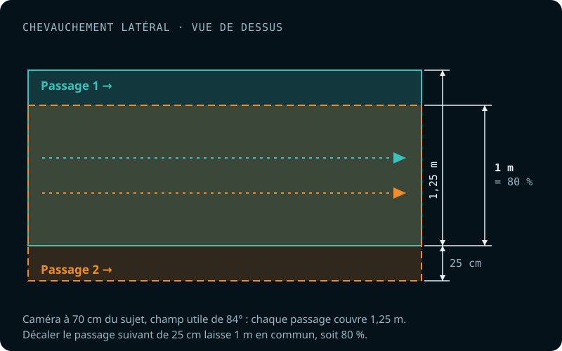

This step pulls still photos out of the videos I shot. I do it in DaVinci Resolve Studio.

## White balance

awef

## Image overlap

The Metashape documentation recommends 80% frontal and 60% side overlap, and 90% frontal and 80% side overlap for a survey over a forest. I chose to aim for 85% overlap, both frontal and side.

### Side overlap

Side overlap is controlled during data collection. So while filming an object, it's important to keep in mind the path you're drawing, so you can plan the next one to get roughly 80% overlap between passes.

<figure>

<figcaption>Two passes with 80 % overlap: at 70 cm from the subject, each pass covers a 1.25 m strip; the next one is shifted by 25 cm (see <a href="/en/questions/dimensions-rig/">Camera rig dimensions</a>).</figcaption>
</figure>

### Frontal overlap

Frontal overlap, on the other hand, is set when extracting the frames from the videos. While watching the footage, I estimate the interval needed between 2 frames to get roughly 85% overlap.

[Explain how I use effects in DaVinci Resolve to show an 85% frame that helps judge the sampling factor.]

<figure>

<figcaption>Two frames of a video overlapping by 85 %: between the frames kept (here 8 frames apart, n8), the camera has moved only 15 % of the filmed area.</figcaption>
</figure>

Rule of thumb:

| Conditions                                                                   | Sampling factor |
| ---------------------------------------------------------------------------- | :-------------: |
| Collected with a scooter, speed 1                                            |       n8        |
| Collected with a scooter, speed 1, camera in portrait mode (turned 90 degrees) |    n6 - n8      |
| Finning, no current                                                          |    n6 - n10     |
| Finning, no current, camera in portrait mode (turned 90 degrees)             |       n8        |
| Drifting                                                                     |                 |

## File compression

This step shrinks the images considerably without losing any data.
