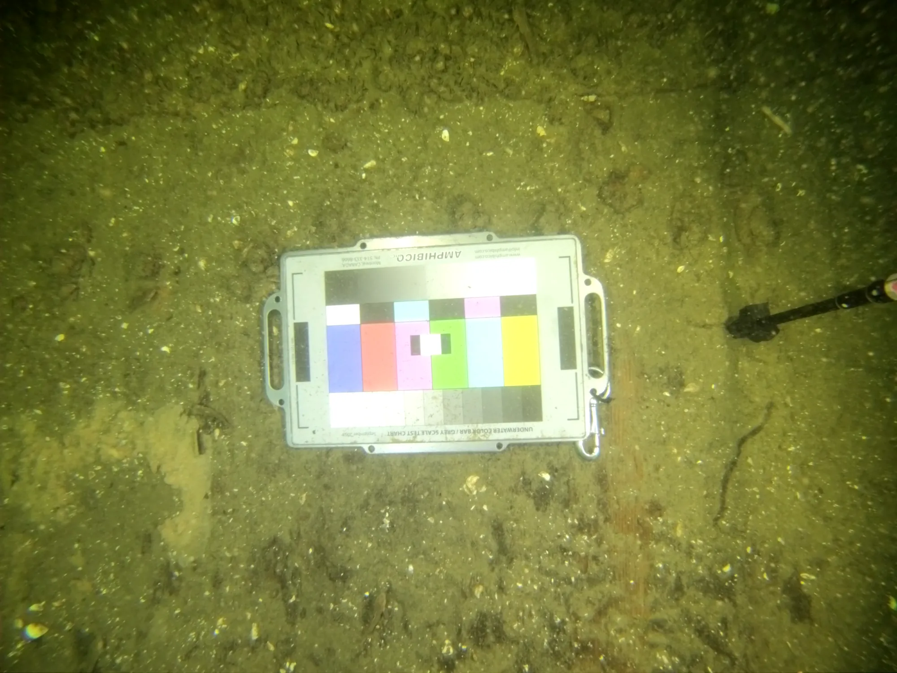
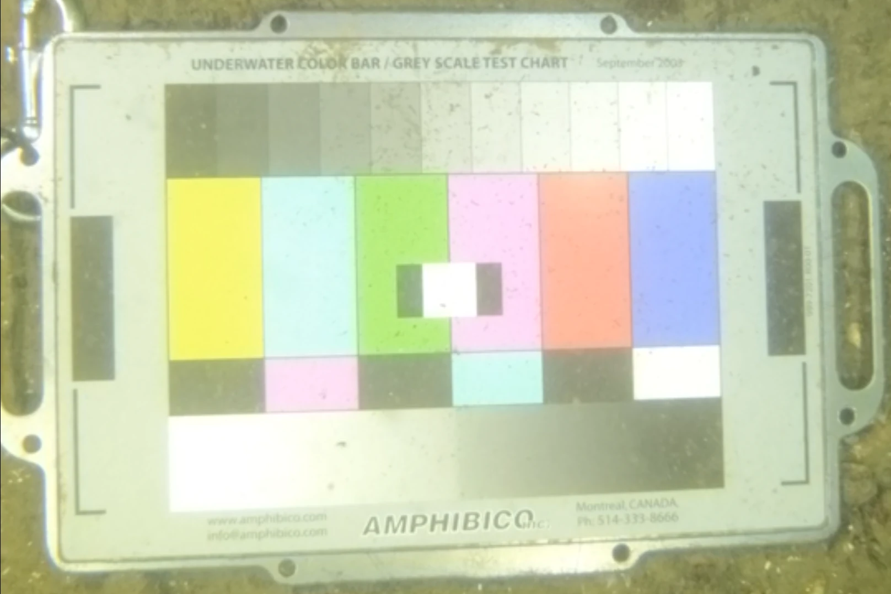
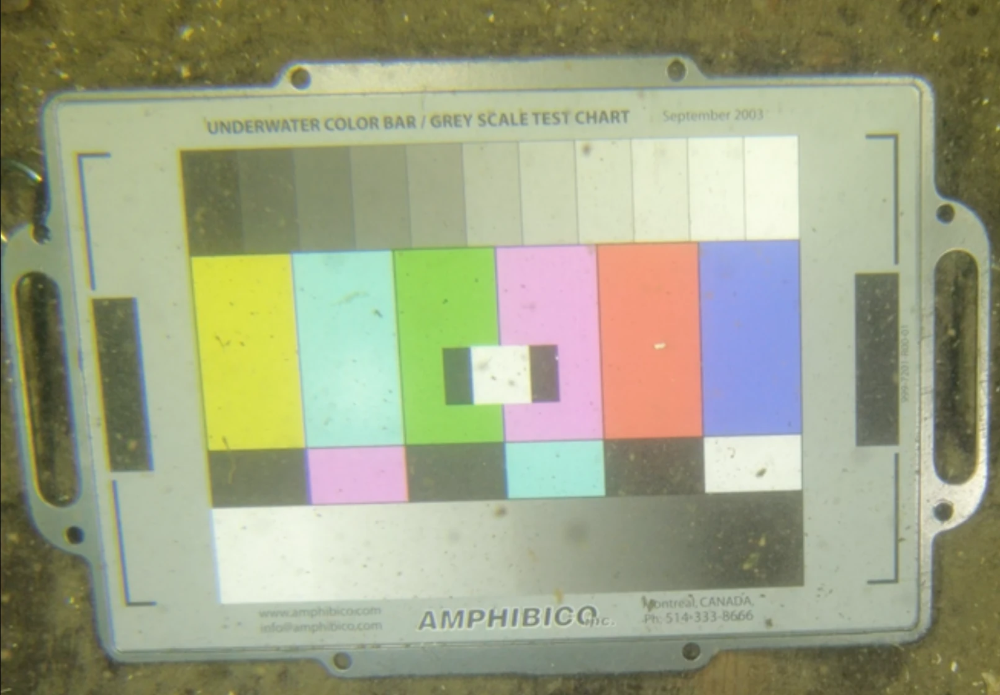
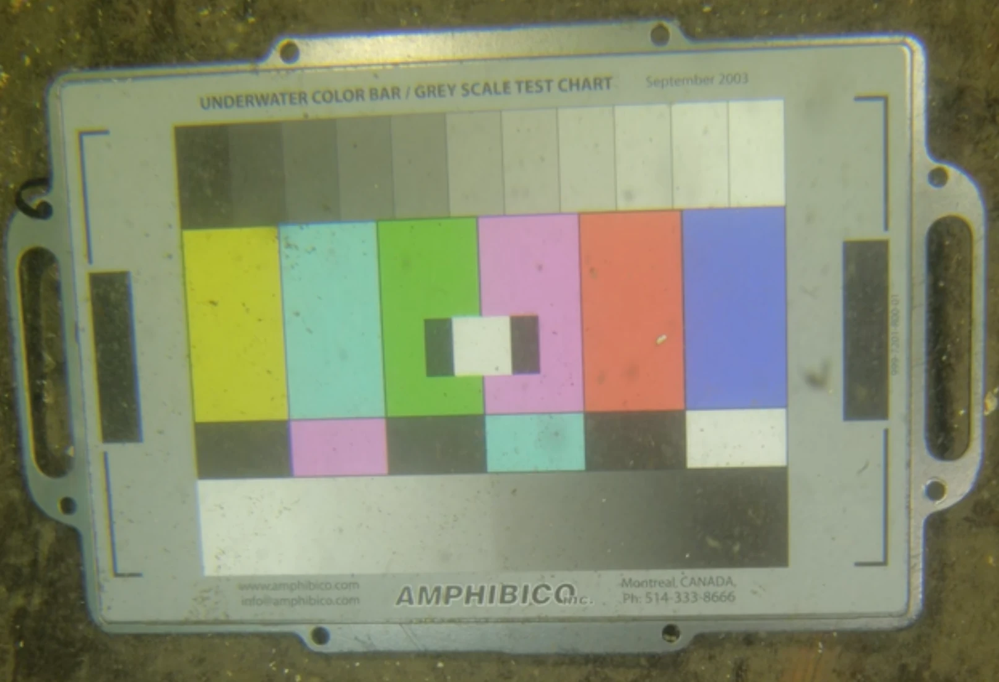

Lors de la prise de vue de la charte de couleurs, à une distance équivalente à celle des collectes des données, soit environ 60cm, la charte occupe un très petit espace dans le champ de la lentille. Comme la luminosité du sol autour de la charte est de beaucoup moindre que la charte elle-même, la caméra surexpose la charte.

<figure>

<figcaption>Exemple du phénomène de surexposition de la charte de couleurs</figcaption>
</figure>

awef

<figure>

<figcaption>Exposition normale</figcaption>
</figure>

<figure>

<figcaption>Exposition à -1 stop</figcaption>
</figure>

<figure>

<figcaption>Exposition à -2 stop</figcaption>
</figure>

## Tests à faire

Pour la première prise de vue de la charte de couleurs, en effectuer deux autres en modifiant le paramètre de la caméra pour sous-exposer respectivement de 1 stop et de 2 stops :

1. Ev comp : -1
2. Ev comp : -2

## Conclusion

Sous-exposer la prise de vue de **-1 stop** lors du calibrage des couleurs.
