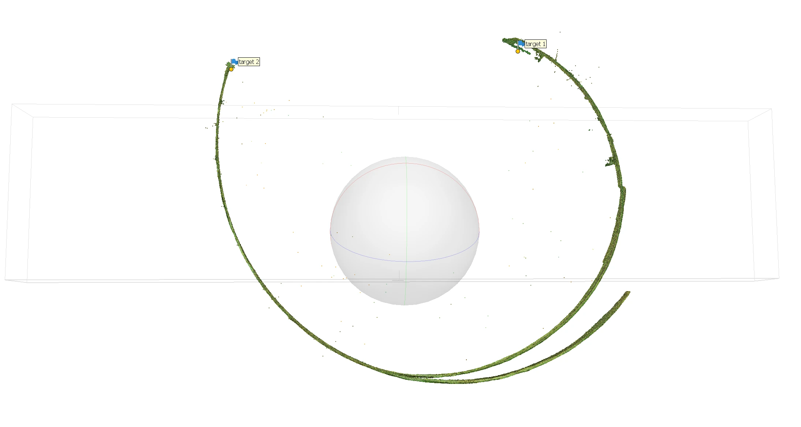
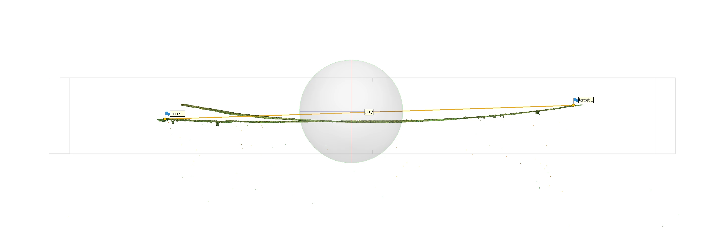
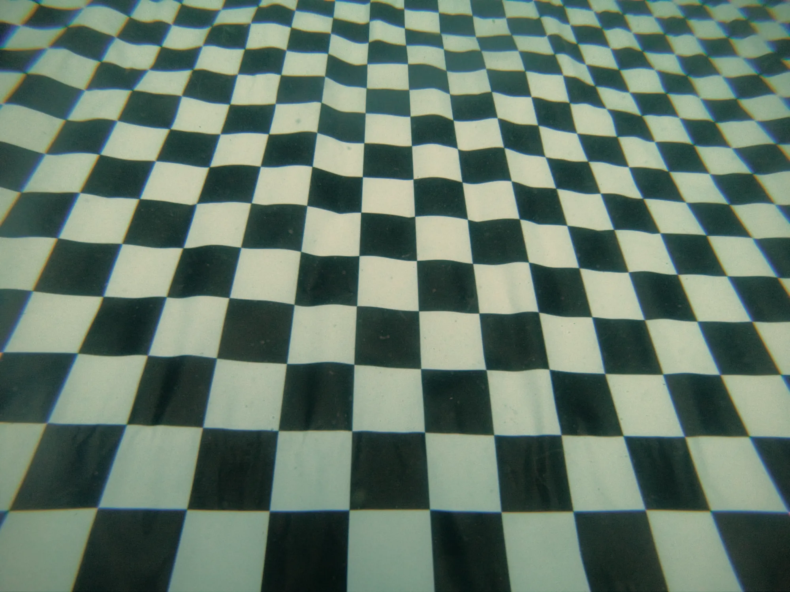
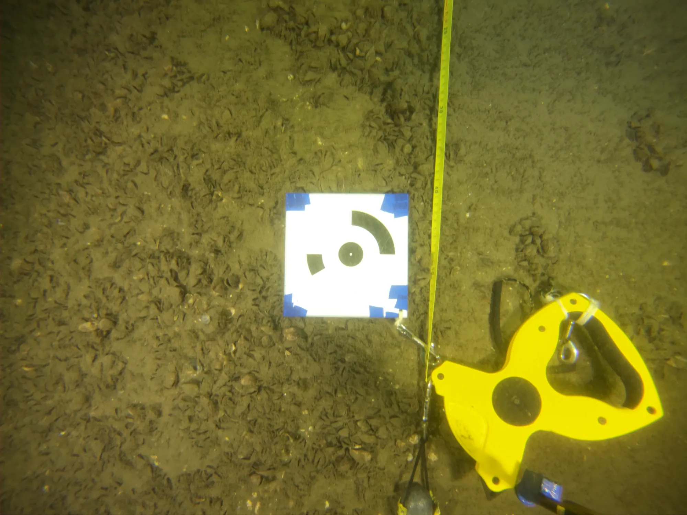

Le test effectué sur une surface plane de 100 pieds de long montre que le modèle résultant de l'alignement des caméras dans le logiciel de photogrammétrie est déformé. Au lieu d'obtenir une surface plate, celle-ci est courbée en forme de banane.

Sur un segment plus long, l'effet est flagrant : les 300 pieds du dessus du mur sud du canal, filmés le 26 juillet 2024 entre les cibles 1 et 2 (plongée 27), s'enroulent presque en cercle.

Segment<b>300 pi</b>

Filmé<b>2024-07-26</b>

Plongée<b>27</b>

<figure>

<figcaption><time datetime="2024-07-26">2024-07-26</time>Le segment de 300 pieds, déformé : il s'enroule entre les cibles 1 et 2</figcaption>
</figure>

<figure>

<figcaption><time datetime="2024-07-26">2024-07-26</time>Le même segment, corrigé : presque droit, avec l'échelle de 300 pieds entre les cibles 1 et 2</figcaption>
</figure>

- D'où vient cette déformation ?
- Comment la corriger ?

## Hypothèse

On présume que l'effet banane vient de la déformation des images par la lentille de la caméra GoPro Hero 6 Black.

Des tests effectuées sur un même jeu d'images - les fichiers `data/2024-05-18/raw-frames-n8/échelle-1` - en utilisant 2 fichiers de calibration de caméra différents, soit celui obtenu à partir du rendu par Metashape du jeu `data/2024-05-18/raw-frames-n8/pilier-3`, `configs/camera-calibration/camera-calibration from 2024-05-18 pillier 3.xml` et le fichier utilisé pour le projet Robert Gaskin `configs/camera-calibration/GoPro HERO6 4k wide frame camera calibration.xml` donnent des courbures différentes : le rendu fait avec la calibration provenant du projet Robert Gaskin a une courbure plus atténuée. On peut donc jouer avec la calibration de la caméra pour corriger l'effet banane.

Les mesures faites ensuite sur le segment de 300 pieds le confirment (voir les conclusions, plus bas).

## Solutions envisagées

1. Effectuer une calibration de la caméra
2. Rogner les bords des images via un masque
3. Utiliser une lentille de moins grand angle

## Calibration de la caméra

Effectuer une collecte de données pour calibrer la lentille de la GoPro.

Calibration Best Practices : [https://calib.io/blogs/knowledge-base/calibration-best-practices](https://calib.io/blogs/knowledge-base/calibration-best-practices)

## En détails

Puisque la longueur focale de la lentille varie en fonction du milieu, le test doit se faire sous l'eau.

Choisir un plan d'eau calme, sans courant, avec la meilleur visibilité possible. Une piscine ou une carrière par exemple.

Le test sera fait à la carrière Bédard à Kahnawake, dimanche le 26 mai 2024.

Afin de s'assurer une bonne collecte de données, et éviter que les images obtenues ne soient pas trop surexposées, effectuer les tests qui suivent avec 4 lampes, puis avec 2 lampes.

1. Déposer un grand damier sur une surface plane. Éviter autant que possible de soulever des sédiments pour ne pas nuire à la visibilité.
2. Faire de brèves vidéos (3 secondes) en 4K 4:3 du damier de tous les angles possibles. Couvrir tout le champ de vision de la caméra avec le damier

<figure>

<figcaption>Image utilisée pour calculer la calibration de la lentille</figcaption>
</figure>

Ce test n'a pas permis d'établir une méthode pour corriger la distorsion des images.

## Traitement dans Metashape

3 échantillons de données ont été créés en filmant un segment de 100 pieds de long du plancher de bois situé derrière les évacuateurs. La distance de 100 pieds a été mesurée à l'aide d'un ruban à mesurer. Les positions 0' et 100' ont été identifiées à l'aide de 2 cibles.

<figure>

<figcaption>Cible utilisée pour identifier la position à 100 pieds</figcaption>
</figure>

### Échantillon 1

Vidéo effectuée à la palme en utilisant le format 4K 16:9.

## Conclusions

Le segment de 300 pieds du 26 juillet 2024 a été aligné dans Metashape avec différentes calibrations de la caméra. Pour comparer leurs courbures, j'ai mesuré en novembre 2026 la trajectoire des 2 138 caméras de chaque essai : son plus grand écart à la ligne droite qui relie ses deux bouts (la flèche), en pourcentage de sa longueur. Une ligne droite donne 0 %, un demi-cercle 50 %.

| Calibration de la caméra | Flèche |
| --- | --- |
| Calculée par Metashape pendant l'alignement (auto-calibration) | 17 à 20 % |
| Calculée sur une autre zone (zones 3, 10, 11 et 12), fixée | 7 à 13 % |
| Fichier `Z18-v2-4x`, fixée | 8 % |
| Calculée sur la zone 2, fixée | 4 % |
| Calculée sur le pilier de la zone 18, avec 16 cibles et des barres d'échelle, fixée (selon la version) | 2 à 16 % |
| Images corrigées de leur distorsion avant Metashape (novembre 2024) | 13 % |

La calibration que Metashape calcule lui-même pendant l'alignement laisse l'effet banane presque entier. Une calibration calculée d'avance puis fixée, que Metashape ne modifie plus, le réduit, mais le résultat dépend beaucoup de la calibration choisie. La meilleure vient du pilier de la zone 18, filmé avec ses cibles et ses barres d'échelle : la flèche passe de 20 % à 2 %. D'autres versions calculées sur ce même pilier donnent 4, 7 et 16 %. Corriger la distorsion des images avant Metashape ne suffit pas à elle seule.

Une calibration ne se juge donc pas d'avance : il faut l'essayer sur une longue surface droite, comme ce segment, avant de s'en servir.

La trajectoire des caméras suit le mur, qui est droit. Elle montre bien la courbure du modèle, sans en être une mesure exacte.

Avec une nouvelle caméra (GoPro HERO13 Black), la calibration est à refaire : sous l'eau, sur une scène avec des cibles et des barres d'échelle, puis vérifiée sur une longue surface droite comme ce segment.
