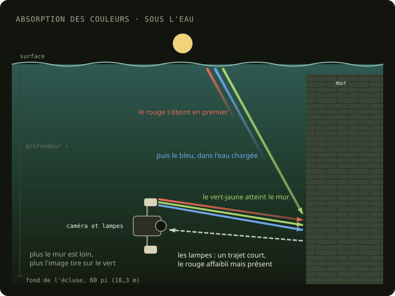
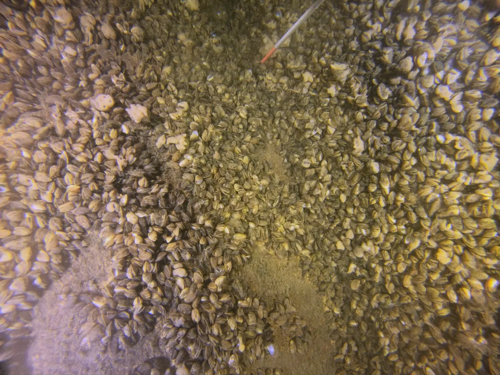
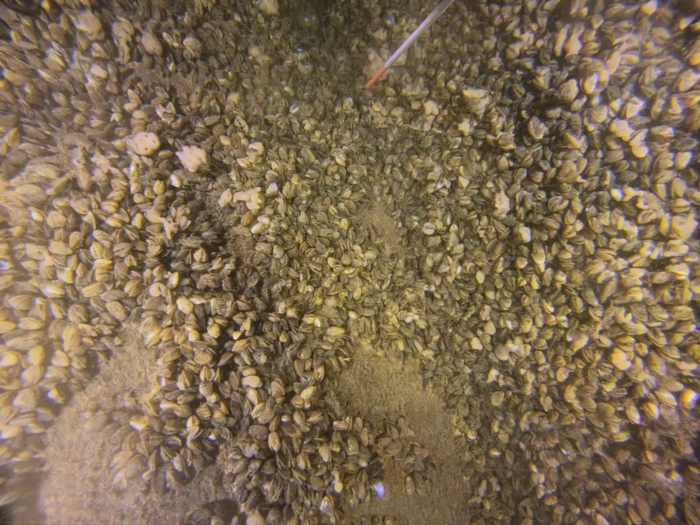
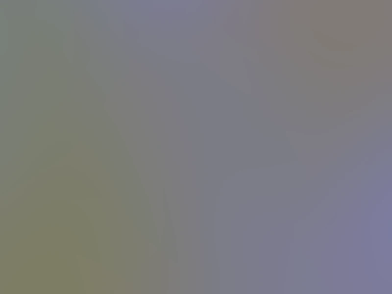

Sous l'eau, deux lumières éclairent ce que je filme : celle du jour, qui descend de la surface, et celle des quatre lampes du [rig](/collecte/rig#les-lampes), des DEL blanches à 6000 K. L'eau ne laisse pas passer toutes les couleurs de la même façon : elle absorbe d'abord le rouge, et dans l'eau chargée du canal, une bonne partie du bleu aussi. Plus la lumière traverse d'eau, plus l'image tire sur le vert-jaune. La lumière du jour change donc avec la profondeur, et celle des lampes avec la distance entre le rig et ce qu'il filme.

<figure id="absorption">

<figcaption>L'eau absorbe les couleurs de la lumière, le rouge en premier. Le jour, qui traverse toute la profondeur, arrive vert-jaune. Les lampes, situées à courte distance du sujet, gardent presque toutes les couleurs, ce qui permet de restaurer les couleurs perdues par l'éclairage ambiant.</figcaption>
</figure>

Dans la caméra, la balance des blancs reste fixe, à 6500 K ([Matériel utilisé](/collecte/materiel-utilise)). La correction se fait ensuite dans DaVinci Resolve, d'après la charte de couleurs filmée au début de chaque plongée, sous-exposée d'un stop ([La charte de couleurs est surexposée](/problemes/charte-couleurs-surexposee)). Pour certaines plongées, j'ai filmé la charte à deux hauteurs, sur le plancher et à mi-hauteur, et fait un étalonnage pour chacune ([Calibration des couleurs](/problemes/calibration-couleurs)).

## La correction ajoutée

En octobre 2026, une correction commune s'est ajoutée à l'étalonnage de la charte, à l'aide de l'outil d'intelligence artificielle Claude, une par plongée. La couleur moyenne de chaque passage, mesurée sur une vingtaine d'images, est ramenée aux trois quarts du chemin vers le gris neutre, et la correction de la plongée est la médiane des passages. Une seule correction par plongée évite les bandes de couleur dans la texture, là où les images de deux passages se mélangent. Pour la plongée 21 et celle du 14 juillet, plus plates que les autres, le contraste est remonté au niveau des autres plongées.

La correction de chaque plongée est enregistrée dans un fichier LUT (_look-up table_, une table de correspondance qui donne, pour chaque couleur de l'image, la couleur corrigée). Dans une copie du projet Resolve de la plongée, nommée `… - graded`, ce fichier est posé sur le nœud de la timeline, qui s'applique à toutes les images après leur propre étalonnage, puis les images sont rendues dans un nouveau dossier, sous les mêmes noms. Les projets et les images d'origine restent tels quels. Les images corrigées passent ensuite à l'[extraction des photos](/traitement/extraction-photos).

## Les lampes au centre de l'image

Une fois la texture d'une zone refaite avec ces images, des taches jaunes sont apparues sur le plancher de la zone 3. La correction de la plongée ramène la couleur moyenne de l'image au neutre, mais la couleur n'est pas la même partout dans l'image : les lampes du rig éclairent le centre d'une lumière chaude, alors que les bords sont éclairés par l'eau, plus verte ou bleutée. Mesurée sur quelques centaines d'images d'une plongée, la part du bleu varie du simple au double entre le centre et les coins. Après la correction commune, le centre reste jaune et les bords tirent sur le magenta. Pour la texture, Metashape prend chaque partie de la surface dans la photo qui la voit le mieux, souvent celle où elle est au centre : une tache jaune, c'est une partie prise au centre d'une photo, et son contour, le passage à une autre photo.

<figure id="lampes-avant">

<figcaption><time datetime="2024-08-18">2024-08-18</time> Zone 4, avec la correction de la plongée seulement : le centre jaune, les bords rosés.</figcaption>
</figure>

<figure id="lampes-apres">

<figcaption><time datetime="2024-08-18">2024-08-18</time> La même image, la couleur égalisée dans l'image.</figcaption>
</figure>

<figure id="carte-correction">

<figcaption>La carte de correction des passages sous les lampes de la plongée du 18 août 2024 : un gris neutre multiplié par la correction de chaque endroit de l'image. Bleutée là où elle ajoute du bleu (sous les lampes), jaunâtre là où elle en retire (les bords que l'eau éclaire).</figcaption>
</figure>

Comme les lampes bougent avec la caméra, ce motif est le même d’une image à l’autre. Pour chaque plongée, ou chaque groupe de passages éclairés de la même façon, la couleur moyenne de chaque endroit de l’image est mesurée sur 400 images par un script écrit avec l'intelligence artificielle, puis lissée. Chaque endroit reçoit ensuite la correction qui ramène sa couleur à celle de l’image entière, sans changer sa luminosité. Seule la teinte est égalisée : le centre, plus éclairé, reste plus clair. Cette carte de correction est ensuite appliquée à toutes les images de la plongée avant de refaire la texture.
