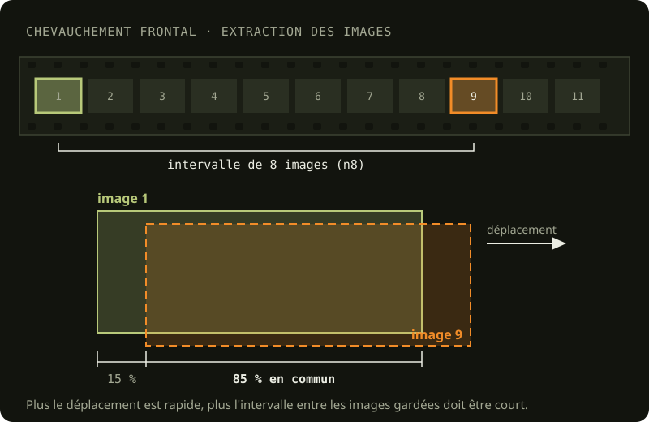

Cette opération consiste à extraire des fichiers photos des vidéos tournés. L'opération s'effectue à l'aide du logiciel DaVinci Resolve Studio.

Les vidéos ont été tournées avec une GoPro Hero6 Black ; la caméra, son boîtier et ses réglages sont décrits dans [Matériel utilisé](/collecte/materiel-utilise).

## Étalonnage

Sous l'eau, deux lumières éclairent ce que je filme : celle du jour, qui descend de la surface, et celle des quatre
lampes du [rig](/collecte/rig#les-lampes), des DEL blanches à 6000 K. L'eau ne laisse pas passer toutes les couleurs
de la même façon : elle absorbe d'abord le rouge, et dans l'eau chargée du canal, une bonne partie du bleu aussi. Plus
la lumière traverse d'eau, plus l'image tire sur le vert-jaune. La lumière du jour change donc avec la profondeur, et
celle des lampes avec la distance entre le rig et ce qu'il filme.

Dans la caméra, la balance des blancs reste fixe, à 6500 K ([Matériel utilisé](/collecte/materiel-utilise)). La
correction se fait ensuite dans DaVinci Resolve, d'après la charte de couleurs filmée au début de chaque plongée,
sous-exposée d'un stop ([La charte de couleurs est surexposée](/problemes/charte-couleurs-surexposee)). Pour certaines
plongées, j'ai filmé la charte à deux hauteurs, sur le plancher et à mi-hauteur, et fait un étalonnage pour chacune
([Calibration des couleurs](/problemes/calibration-couleurs)).

### Ce que la zone 3 a montré

Dans le modèle, le mur des trois vannes de la zone 3 sortait jaune-olive. Ses images viennent de la plongée 21
(2024-07-12), étalonnée avec une seule charte, posée sur le plancher, alors que les passages montent le long du mur.
Sur la charte, le gris sortait bien neutre ; sur le mur, il manquait du bleu. Les autres plongées de la zone avaient
le même défaut, plus ou moins marqué : la charte corrige la lumière là où elle est posée, pas sur toute la hauteur
d'un mur.

### La correction ajoutée

En octobre 2026, une correction commune s'est ajoutée à l'étalonnage de la charte, une par plongée. La couleur moyenne
de chaque passage, mesurée sur une vingtaine d'images, est ramenée aux trois quarts du chemin vers le gris neutre, et
la correction de la plongée est la médiane des passages. Une seule correction par plongée évite les bandes de couleur
dans la texture, là où les images de deux passages se mélangent. Pour la plongée 21 et celle du 14 juillet, plus
plates que les autres, le contraste est remonté au niveau des autres plongées.

La correction est posée dans une copie du projet Resolve de chaque plongée, et les images sont rendues dans un nouveau
dossier, sous les mêmes noms ; les projets et les images d'origine restent tels quels.

## Le chevauchement des images

La documentation de Metashape recommande un chevauchement de 80% frontal et 60% latéral, et 90% frontal et 80% latéral pour un relevé au-dessus d'une forêt. J'ai choisi de viser un chevauchement frontal et latéral de 85%.

### Chevauchement latéral

Le chevauchement latéral est contrôlé au moment de la collecte des données. Il est donc important qu'au moment où on filme un objet on garde en tête la trajectoire qu'on est en train de dessiner afin de prévoir celle qui suit en fonction d'obtenir un recoupement des trajets d'environ 80%.

<figure>

<figcaption>Deux passages recoupés à 80 % : à 70 cm du sujet, chaque passage couvre une bande de 1,25 m ; on décale le suivant de 25 cm (voir <a href="/problemes/dimensions-rig">Dimensions du rig de caméra</a>).</figcaption>
</figure>

### Chevauchement frontal

Le chevauchement frontal, lui, est obtenu au moment d'extraire les images des vidéos. En visionnant les prises de vues, on estime l'intervalle nécessaire entre 2 images pour obtenir un recoupement d'environ 85%.

[Expliquer comment j'utilise les effets dans Davinci Resolve pour afficher un cadre à 85% qui aide à évaluer le facteur d'échantillonage.]

<figure>

<figcaption>Deux images d'un film qui se recoupent à 85 % : entre les images gardées (ici à 8 images d'intervalle, n8), la caméra n'a avancé que de 15 % de la zone filmée.</figcaption>
</figure>

Règle du pouce :

| Conditions                                                                   | Facteur d'échantillonage |
| ---------------------------------------------------------------------------- | :----------------------: |
| Collecte en scooter, vitesse 1                                               |            n8            |
| Collecte en scooter, vitesse 1, caméra en mode portrait (tourné à 90 degrés) |         n6 - n8          |
| À la palme, sans courant                                                     |         n6 - n10         |
| À la palme, sans courant, caméra en mode portrait (tourné à 90 degrés)       |            n8            |
| En dérive                                                                    |                          |

## Compression des fichiers

Cette étape permet de réduire considérablement la taille des images sans aucune perte de données.
