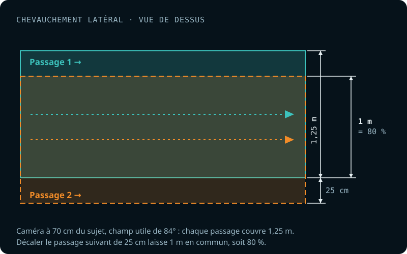
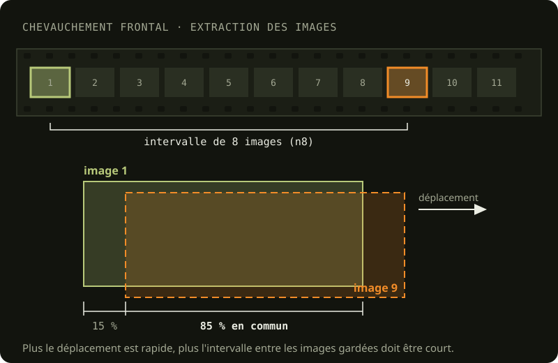

Cette opération consiste à extraire des fichiers photos des vidéos tournés. L'opération s'effectue à l'aide du logiciel DaVinci Resolve Studio.

Les vidéos ont été tournées avec une GoPro Hero6 Black. La caméra, son boîtier et ses réglages sont décrits dans [Matériel utilisé](/collecte/materiel-utilise).

Les clips sont d'abord étalonnés dans DaVinci Resolve ([Étalonnage des couleurs](/traitement/etalonnage-couleurs)), puis rendus en images.

## Le renommage des vidéos

Avant l'étalonnage, les vidéos sont renommées dans leur dossier `raw-4k` avec l'utilitaire Bulk Rename Utility (préréglage `O:\scripts\renameFiles.bru`). La GoPro met le numéro du chapitre avant celui de la vidéo : `GX020333.MP4` est le chapitre 02 de la vidéo 0333. Le renommage inverse les deux, ce qui garde les chapitres d'une même vidéo ensemble quand les fichiers sont triés par nom :

| Motif | Remplacement | Avant | Après |
| --- | --- | --- | --- |
| `GX(\d{2})(\d+)(.*)` | `GX\2\1\3` | `GX020333.MP4` | `GX033302.MP4` |

Les images extraites reprennent ensuite le nom de leur vidéo, suivi de leur numéro : `GX033001.0001.tif`.

Ce préréglage date de juillet 2024. Les vidéos d'avant ont d'autres formes de noms (`GX0019201`, `GX002071`), et celles de la zone 7 du 24 juin 2024 ont gardé leur nom d'origine (`GX010247`).

## Le chevauchement des images

La documentation de Metashape recommande un chevauchement de 80% frontal et 60% latéral, et 90% frontal et 80% latéral pour un relevé au-dessus d'une forêt. J'ai choisi de viser un chevauchement frontal et latéral de 85%.

### Chevauchement latéral

Le chevauchement latéral est contrôlé au moment de la collecte des données. Il est donc important qu'au moment où on filme un objet on garde en tête la trajectoire qu'on est en train de dessiner afin de prévoir celle qui suit en fonction d'obtenir un recoupement des trajets d'environ 80%.

<figure>

<figcaption>Deux passages recoupés à 80 % : à 70 cm du sujet, chaque passage couvre une bande de 1,25 m. On décale le suivant de 25 cm (voir <a href="/problemes/dimensions-rig">Dimensions du rig de caméra</a>).</figcaption>
</figure>

### Chevauchement frontal

Le chevauchement frontal, lui, est obtenu au moment d'extraire les images des vidéos. En visionnant les prises de vues, on estime l'intervalle nécessaire entre 2 images pour obtenir un recoupement d'environ 85%.

[Expliquer comment j'utilise les effets dans Davinci Resolve pour afficher un cadre à 85% qui aide à évaluer le facteur d'échantillonage.]

<figure>

<figcaption>Deux images d'un film qui se recoupent à 85 % : entre les images gardées (ici à 8 images d'intervalle, n8), la caméra n'a avancé que de 15 % de la zone filmée.</figcaption>
</figure>

Règle du pouce :

| Conditions                                                                   | Facteur d'échantillonage |
| ---------------------------------------------------------------------------- | :----------------------: |
| Collecte en scooter, vitesse 1                                               |            n8            |
| Collecte en scooter, vitesse 1, caméra en mode portrait (tourné à 90 degrés) |         n6 - n8          |
| À la palme, sans courant                                                     |         n6 - n10         |
| À la palme, sans courant, caméra en mode portrait (tourné à 90 degrés)       |            n8            |
| En dérive                                                                    |                          |

## Compression des fichiers

Cette étape permet de réduire considérablement la taille des images sans aucune perte de données. DaVinci Resolve rend les images en TIFF sans compression, environ 34 Mo chacune. Elles sont ensuite compressées en LZW, un format sans perte que Metashape lit directement, ce qui les ramène à environ 14 Mo. Le script `compress_tiffs.mjs` (avec ImageMagick) le fait sur place : chaque image n'est remplacée qu'une fois ses pixels comparés à ceux de l'originale.
